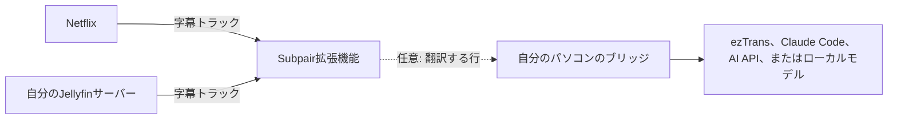
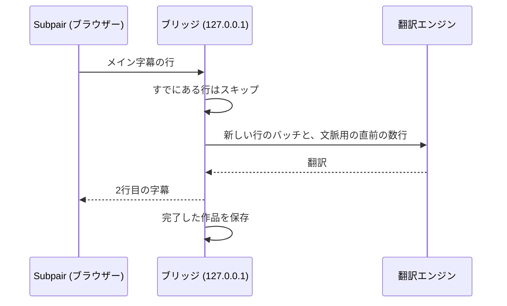

# Subpair

[English](README.md) | [한국어](README.ko.md) | 日本語

**Netflixとご自身のJellyfinライブラリで使える、Language Reactorの無料でオープンソースの代替**です。Subpairは学習中の言語と自分の言語の字幕2行を同時に表示し、1行リピート、自動一時停止、トランスクリプトパネル、クリックできる単語に対応します。

- **無料、MITライセンス**：アカウント不要、トラッキングなし。
- Netflixだけでなく、**ご自身のJellyfinライブラリ**にも対応しています。
- **翻訳**：作品に自分の言語の字幕がないときは、パソコン上の小さな補助プログラムが翻訳します。Claude、任意のOpenAI互換モデル、ローカルモデル、またはオフラインのezTransを使えます。翻訳は保存されて再利用され、次の話は先に翻訳され、Jellyfinではシーズン全体を一度に翻訳します。
- **日本語の単語の色分け**と、Yomitanによるワンクリック検索。
- **英語、韓国語、日本語**のインターフェース。

**Webサイト：[wonjoonseol-ws.github.io/subpair/ja](https://wonjoonseol-ws.github.io/subpair/ja/)**


## しくみ



拡張機能は再生中の動画の字幕トラックを読み取り、そのうち2つを表示します。自分の言語のトラックがない場合は、パソコン上で動く小さなNode.jsプログラムである**ブリッジ**（任意）がメイン字幕を翻訳し、結果を保存します。

## インストール

**ブラウザーのストアから**：Chrome Web StoreとFirefox Add-onsでの公開は近日予定です。

**ソースから**（Chrome 111+、Edge、Brave、Firefox 128+）：

1. このリポジトリをダウンロードするか、クローンします。
2. ChromeまたはEdge：`chrome://extensions`（Edgeでは`edge://extensions`）を開き、**デベロッパー モード**をオンにして、**パッケージ化されていない拡張機能を読み込む**をクリックし、このフォルダーを選びます。
   Firefox：`npm run build:firefox`を実行し、`about:debugging#/runtime/this-firefox`を開いて**一時的なアドオンを読み込む**をクリックし、`dist/firefox/manifest.json`を選びます（Firefoxを再起動するまでの一時的なインストールです）。

## はじめて使うとき

1. 設定ページが自動的に開きます。**メイン字幕**（学習中の言語）と**2行目の字幕**（自分の言語。ブラウザーの言語があらかじめ選ばれています）を選び、**設定を保存**を押します。
2. **Netflix**：インストール後にNetflixのタブを一度再読み込みしてから、作品を再生します。
3. **Jellyfin**：サーバーのWebクライアントを開き、ブラウザーのツールバーにあるSubpairボタンを一度押します（ボタンが見えない場合は、拡張機能メニューから固定してください）。アドレスが`localhost`または`127.0.0.1`でない場合は、ブラウザーが先にそのサーバーを許可するか確認します。設定の「**Jellyfinサーバー**」でアドレスを追加することもできます。そのあと、テキスト字幕のあるアイテムを再生します。

| キー | 操作 |
|---|---|
| `A` / `R` / `D` | 前の行 / この行をリピート / 次の行 |
| `Q` | 各行の終わりで自動一時停止 |
| クリック / Ctrl+クリック / Alt+クリック | 単語 / 辞書形 / 行全体をコピー |
| Alt+Shift+S、またはツールバーボタン | Subpairのオン/オフ（サイト自体の字幕に戻ります） |

動画上の歯車ボタンで、視聴中の動画の言語、翻訳エンジン、タイミング、サイズ、位置、背景を変更できます。キーは設定で変更できます。

## 翻訳（任意）

作品に2行目の字幕の言語のトラックがない場合、**ブリッジ**（翻訳用の補助プログラム。`bridge/`にある小さなNode.jsプログラム）がメイン字幕を翻訳します。誰でも進められる手順（WindowsのezTransから）は[翻訳ページ](https://wonjoonseol-ws.github.io/subpair/ja/translation.html)にあります。要点は次のとおりです。

1. [Node.js](https://nodejs.org/) 21以降をインストールします。ブリッジはNodeの組み込みモジュールだけを使うので、`npm install`は不要です。
2. 起動します。Windowsでは`start-bridge.cmd`をダブルクリックし、どのOSでも`npm run bridge`（`node bridge/server.mjs`と同じ）で起動できます。拡張機能の既定のブリッジのアドレスである`http://127.0.0.1:8765`で待ち受けます。
3. 翻訳エンジンを設定し（[ブリッジの設定](#ブリッジの設定)）、`http://127.0.0.1:8765/health`を確認してから、Subpairの設定または歯車メニューで翻訳エンジンを選びます。

問題があるときは[docs/ja/troubleshooting.md](docs/ja/troubleshooting.md)を参照してください。

## おすすめ：Yomitan

[Yomitan](https://yomitan.wiki/)のクリップボードの監視をオンにすると、Subpairでクリックした単語がすべて調べられます。または、単語の上でShiftを押し続けると、Yomitanのポップアップが表示されます。


## 対応プラットフォーム

| | Windows | macOS | Linux |
|---|---|---|---|
| 拡張機能 | 対応 | 対応 | 対応 |
| Claude Code、AI API、またはローカルモデルを使うブリッジ | 対応 | 対応 | 対応 |
| ezTrans | 対応 | 非対応 | 非対応 |

作者がテストしているのはWindowsだけです。

## プライバシー

翻訳をオンにしない限り、データがパソコンの外に出ることはありません。翻訳をオンにすると、字幕の行は`127.0.0.1`のブリッジに送られ、そこから選んだ翻訳エンジンに送られます。Subpairは、有効にしたJellyfinサーバーでのみ動作します。詳しくは[プライバシーポリシー](https://wonjoonseol-ws.github.io/subpair/ja/privacy.html)をご覧ください。

## ブリッジの設定

ブリッジは翻訳したすべての行と完了したすべての作品を保存するため、同じ翻訳に二度料金を払うことはなく、一度見た作品はすぐに読み込まれます。



### 設定ファイル

ブリッジは、優先度の低いものから順に次の設定を読み込みます。

1. `bridge/config.defaults.json`：すべての設定とその既定値です（コードの一部なので編集しないでください）。
2. `bridge/config.json`：自分で変更した設定です。`bridge/config.example.json`をもとに作成してください。APIキーを含むことがあるため、gitの管理対象から除外されています。
3. 環境変数：`BRIDGE_PORT`、`BRIDGE_STORE`、`ANTHROPIC_API_KEY`、`OPENAI_API_KEY`。

既定値ファイルにない設定名はエラーになるため、タイプミスのせいで設定が黙って無視されることはありません。設定や環境変数を変更したら、ブリッジを再起動してください。

### 翻訳エンジン

| 翻訳エンジン | キー | 設定方法 |
|---|---|---|
| ezTrans | なし | Windowsのみ、日本語から韓国語。[ezTrans](#eztrans)を参照してください。 |
| Claude (`claude -p`) | なし | [Claude Code](https://claude.com/claude-code)をインストールし、ブリッジを実行するのと同じユーザーで`claude`を一度実行してログインします。翻訳はClaudeのプランの使用量に含まれます。 |
| Anthropic API | `ANTHROPIC_API_KEY`または`api.key` | 既定のモデルは`claude-haiku-5-5`です。 |
| OpenAI互換（OpenAI、Gemini、DeepSeek、Ollama、LM Studioなど） | `OPENAI_API_KEY`または`openai.key` | `openai.baseUrl`と`openai.model`を設定します。自分のパソコンやローカルネットワーク上のサーバーは、通常キーが不要です。 |

`claude`コマンドはシェルを介さずに起動されます。Windowsでは、Claude Codeをネイティブインストーラー（PATH上の`.exe`）でインストールするか、`claude.command`に`claude.exe`のフルパスを設定してください。

GeminiのOpenAI互換エンドポイントを使う`bridge/config.json`の例：

```json
{
  "openai": {
    "baseUrl": "https://generativelanguage.googleapis.com/v1beta/openai",
    "model": "<a Gemini model name>"
  }
}
```

ローカルの[Ollama](https://ollama.com/)の場合：

```json
{ "openai": { "baseUrl": "http://127.0.0.1:11434/v1", "model": "<the model you pulled>" } }
```

キーは、ブリッジを起動するターミナルまたはサービスに設定します。

| システム | このセッションのみ | 永続的に |
|---|---|---|
| Windows PowerShell | `$env:OPENAI_API_KEY = "<key>"; npm run bridge` | `setx OPENAI_API_KEY "<key>"`を実行し、新しいターミナルを開く |
| macOS、Linux（bash、zsh） | `OPENAI_API_KEY="<key>" npm run bridge` | `~/.zshrc`または`~/.bashrc`に`export OPENAI_API_KEY="<key>"`を追加 |

launchd（macOS）やsystemd（Linux）で起動するサービスは、シェルのプロファイルを読み込みません。キーは`bridge/config.json`かサービス定義に記述してください。

### ezTrans

ezTrans XPは、日本語を韓国語に翻訳するWindows用のソフトウェアです。Subpairには含まれていないため、ご自身でインストールしてください。ブリッジはLunaTranslatorの32ビット版ヘルパーを介してezTransとやり取りします。このヘルパーはSubpairに同梱されており、`bridge/vendor/lunatranslator`にあります（GPL-3.0、LunaTranslatorの公式リリースから取得。ソースとバージョンはそのフォルダーのREADMEに記載）。

ブリッジはezTrans XPのフォルダーを自動で探し、次のうちエンジン（`J2KEngine.dll`）がある最初のフォルダーを使います。

1. `bridge/config.json`の`eztrans.dir`
2. ezTrans XPが現在のユーザーに記録したフォルダー（レジストリ`HKEY_CURRENT_USER\Software\ChangShin\ezTrans`の値`FilePath`）
3. Program Files (x86)、次にProgram Filesの下の`ChangShinSoft\ezTrans XP`

使うフォルダーは起動時に表示されます。フォルダーを自分で指定するには：

```json
{ "eztrans": { "dir": "D:/Apps/ezTrans XP" } }
```

同梱のヘルパーではなく自分で用意したヘルパーを使うには、`eztrans.helper`にそのフルパスを設定してください（別の作業フォルダーが必要な場合は`eztrans.cwd`も設定します）。macOSとLinuxではezTransは使えないので、ほかの翻訳エンジンを使ってください。

### モデル

Subpairの設定には、翻訳エンジンごとに**モデル**欄があります。空欄の場合はブリッジの既定値が使われ、ブリッジの起動中はその値がグレーで表示されます。このブリッジを使うすべての人の既定値を変えるには、`bridge/config.json`で設定します。例：

```json
{ "claude": { "model": "sonnet" } }
```

モデル名には英字、数字、`. : / - _`を使えます。翻訳はモデルごとに別々に保存されるため、モデルを切り替えても翻訳が混ざることはありません。

### 行の送り方

- **ezTrans**は、動画の数行先までを1行ずつ翻訳します。
- **言語モデル**には、最大40行を番号付きリストにしたバッチと、そのバッチの直前の6行を文脈として送ります。作品全体は複数のバッチに分割され、翻訳済みの行（または繰り返しの行）はスキップされ、同時に2つのバッチ（Anthropic APIでは3つ）が処理されます。結果がおかしかったバッチは半分に分けて再試行し、それでも失敗した1行は、作品全体を失敗させるのではなくその行だけ除外されます。

翻訳エンジンごとに、`bridge/config.json`で`batch`、`context`、`concurrency`、`timeoutMs`を変更できます。

### 費用

Anthropic APIとClaude Haiku 5.5（`claude-haiku-5-5`、既定値）で、約300行のアニメ1話を翻訳した場合のおおよその費用です。料金は10万トークン未満のリクエストで入力100万トークンあたり$0.10（約16円）、出力100万トークンあたり$0.50（約79円）で（[Anthropicの料金](https://www.anthropic.com/pricing)）、2026年10月の為替レート1ドル約158円で換算しています。

| | 1話あたり | 12話の1シーズン |
|---|---|---|
| リクエスト | 約8回（40行ずつのバッチ） | 約96回 |
| 入力 | 1リクエストあたり約1,500トークン | |
| 出力 | 1リクエストあたり約1,200〜2,000トークン | |
| **費用** | **約1〜2円** | **約11〜19円**（再試行込みでも50円未満） |

これらは実測値ではなく推定値です。日本語や韓国語の1文字を約1トークン、リクエストごとに250トークンの指示と6行の文脈、`api.effort`を`low`に設定した場合を前提にしています。翻訳済みの行に再び料金がかかることはありません。Claude翻訳エンジン（`claude -p`）はトークン単位の課金ではなくClaudeのプランを使い、ezTransとローカルモデルは行ごとの費用がかかりません。

### 保存された翻訳

完了した作品は、ブリッジのデータフォルダーに保存されます。Windowsは`%LOCALAPPDATA%\subpair`、macOSは`~/Library/Application Support/subpair`、Linuxは`$XDG_DATA_HOME/subpair`または`~/.local/share/subpair`です（`storeDir`または`BRIDGE_STORE`で変更できます）。ほかのJellyfinアプリ（テレビ、スマートフォン）では、保存された翻訳は表示されません。

### 起動時にブリッジを実行する

**Windows**：`scripts\windows\autostart-on.cmd`をダブルクリックします。スタートアップフォルダーにショートカットを作り、サインインのたびに`scripts\windows\run-bridge.ps1`を非表示で実行し（管理者権限は不要）、今すぐ起動もします。`autostart-off.cmd`はショートカットを削除し、そのブリッジを停止します。

`run-bridge.ps1`は、ブリッジが停止すると再起動し（5秒待ってから、待ち時間を倍にしながら最大60秒まで延ばし、短時間での失敗が8回続くとあきらめます）、ポートごとに1つしか実行されないようにし、そのポートで動いたままのブリッジを停止して、出力をログ（既定は`%LOCALAPPDATA%\subpair\bridge.log`）に追記します。オプションは`-Port`、`-Log`、`-Repo`、`-Node`、`-MaxQuickFailures`です。

開発用のブリッジと並べて常に動かしておくブリッジには、8777など別のポートを使い、拡張機能の**ブリッジのアドレス**も同じポートに設定してください。ログオン時に起動し、5分ごとに確認するタスクとしてタスクスケジューラに登録するには（PowerShellで、リポジトリのフォルダーから実行）：

```powershell
$script   = (Resolve-Path 'scripts\windows\run-bridge.ps1').Path
$action   = New-ScheduledTaskAction -Execute 'powershell.exe' -Argument "-WindowStyle Hidden -NoProfile -ExecutionPolicy Bypass -File `"$script`" -Port 8777"
$triggers = @(
  New-ScheduledTaskTrigger -AtLogOn -User "$env:USERDOMAIN\$env:USERNAME"
  New-ScheduledTaskTrigger -Once -At (Get-Date).Date -RepetitionInterval (New-TimeSpan -Minutes 5)
)
$settings = New-ScheduledTaskSettingsSet -ExecutionTimeLimit (New-TimeSpan -Seconds 0) -MultipleInstances IgnoreNew -AllowStartIfOnBatteries -DontStopIfGoingOnBatteries
Register-ScheduledTask -TaskName 'Subpair bridge' -Action $action -Trigger $triggers -Settings $settings
Start-ScheduledTask -TaskName 'Subpair bridge'
```

`Invoke-RestMethod http://127.0.0.1:8777/health`で確認できます。完全に止めるには、`Unregister-ScheduledTask -TaskName 'Subpair bridge'`を実行してから、`bridge\server.mjs`を実行している`node`プロセスを終了します。

**macOS**（未検証）：次の内容を、パスを自分の環境に合わせて`~/Library/LaunchAgents/com.subpair.bridge.plist`として保存します（Nodeのパスは`which node`で確認できます）。

```xml
<?xml version="1.0" encoding="UTF-8"?>
<!DOCTYPE plist PUBLIC "-//Apple//DTD PLIST 1.0//EN" "http://www.apple.com/DTDs/PropertyList-1.0.dtd">
<plist version="1.0">
<dict>
  <key>Label</key><string>com.subpair.bridge</string>
  <key>ProgramArguments</key>
  <array><string>/opt/homebrew/bin/node</string><string>/path/to/subpair/bridge/server.mjs</string></array>
  <key>RunAtLoad</key><true/>
  <key>KeepAlive</key><true/>
  <key>StandardOutPath</key><string>/tmp/subpair-bridge.log</string>
  <key>StandardErrorPath</key><string>/tmp/subpair-bridge.log</string>
</dict>
</plist>
```

その後、`launchctl bootstrap gui/$(id -u) ~/Library/LaunchAgents/com.subpair.bridge.plist`を実行します。

**Linux**（未検証）：次の内容を`~/.config/systemd/user/subpair-bridge.service`として保存します。

```ini
[Unit]
Description=Subpair translation bridge

[Service]
ExecStart=/usr/bin/node /path/to/subpair/bridge/server.mjs
Restart=on-failure

[Install]
WantedBy=default.target
```

その後、`systemctl --user enable --now subpair-bridge`を実行します。

### Subpairだけを許可する

初期設定では、このパソコンのどのブラウザー拡張機能もブリッジを呼び出せます。ブリッジは起動時にそのことを表示します。Subpairだけを許可するには、`bridge/config.json`にSubpairのオリジンを追加して、ブリッジを再起動してください。

```json
{ "allowedOrigins": ["chrome-extension://<the ID shown on chrome://extensions>"] }
```

Firefoxでは`moz-extension://<about:debugging#/runtime/this-firefoxに表示される内部UUID>`を使います。拡張機能を別のフォルダーから読み込むとIDが変わり、IDを更新するまで、ブリッジは「許可されていないオリジン」と応答します。

## コントリビュートとライセンス

[CONTRIBUTING.md](CONTRIBUTING.md)を参照してください。MITライセンスです。`vendor/kuromoji`はApache-2.0、`bridge/vendor/lunatranslator`（ezTransのヘルパー）はGPL-3.0です。Netflix、Jellyfin、Language Reactorとは提携していません。
