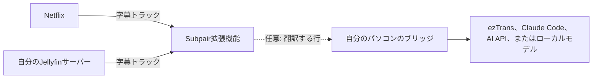

# Subpair

[English](README.md) | [한국어](README.ko.md) | 日本語

**Netflixとご自身のJellyfinライブラリで使える、Language Reactorの無料でオープンソースの代替**です。Subpairは学習中の言語と自分の言語の字幕2行を同時に表示し、1行リピート、自動一時停止、トランスクリプトパネル、クリックできる単語に対応します。

- **無料、MITライセンス**：アカウント不要、トラッキングなし。
- Netflixだけでなく、**ご自身のJellyfinライブラリ**にも対応しています。
- **翻訳**：作品に自分の言語の字幕がないときは、パソコン上の小さな補助プログラムが翻訳します。Claude、任意のOpenAI互換モデル、ローカルモデル、またはオフラインのezTransを使えます。翻訳は保存されて再利用され、次の話は先に翻訳され、Jellyfinではシーズン全体を一度に翻訳します。
- **日本語の単語の色分け**と、Yomitanによるワンクリック検索。
- **英語、韓国語、日本語**のインターフェース。

**Webサイト：[wonjoonseol-ws.github.io/subpair/ja](https://wonjoonseol-ws.github.io/subpair/ja/)**

## しくみ

拡張機能は再生中の動画の字幕トラックを読み取り、そのうち2つを表示します。自分の言語のトラックがない場合は、パソコン上で動く小さなNode.jsプログラムである**ブリッジ**（任意）がメイン字幕を翻訳し、結果を保存します。

## インストール

**ブラウザーのストアから**：Chrome Web StoreとFirefox Add-onsでの公開は近日予定です。

**ソースから**（Chrome 111+、Edge、Brave、Firefox 128+）：

1. このリポジトリをダウンロードするか、クローンします。
2. ChromeまたはEdge：`chrome://extensions`（Edgeでは`edge://extensions`）を開き、**デベロッパー モード**をオンにして、**パッケージ化されていない拡張機能を読み込む**をクリックし、このフォルダーを選びます。
   Firefox：`npm run build:firefox`を実行し、`about:debugging#/runtime/this-firefox`を開いて**一時的なアドオンを読み込む**をクリックし、`dist/firefox/manifest.json`を選びます（Firefoxを再起動するまでの一時的なインストールです）。

## はじめて使うとき

1. 設定ページが自動的に開きます。**メイン字幕**（学習中の言語）と**2行目の字幕**（自分の言語。ブラウザーの言語があらかじめ選ばれています）を選び、**設定を保存**を押します。
2. **Netflix**：インストール後にNetflixのタブを一度再読み込みしてから、作品を再生します。
3. **Jellyfin**：サーバーのWebクライアントを開き、ブラウザーのツールバーにあるSubpairボタンを一度押します（ボタンが見えない場合は、拡張機能メニューから固定してください）。アドレスが`localhost`または`127.0.0.1`でない場合は、ブラウザーが先にそのサーバーを許可するか確認します。設定の「**Jellyfinサーバー**」でアドレスを追加することもできます。そのあと、テキスト字幕のあるアイテムを再生します。

| キー | 操作 |
|---|---|
| `A` / `R` / `D` | 前の行 / この行をリピート / 次の行 |
| `Q` | 各行の終わりで自動一時停止 |
| クリック / Ctrl+クリック / Alt+クリック | 単語 / 辞書形 / 行全体をコピー |
| Alt+Shift+S、またはツールバーボタン | Subpairのオン/オフ（サイト自体の字幕に戻ります） |

動画上の歯車ボタンで、視聴中の動画の言語、翻訳エンジン、タイミング、サイズ、位置、背景を変更できます。キーは設定で変更できます。

## 翻訳（任意）

1. [Node.js](https://nodejs.org/) 21以降をインストールし、このフォルダーで`npm install`を実行します。
2. `bridge/config.example.json`を`bridge/config.json`にコピーし、翻訳エンジンを1つ設定します。

   | 翻訳エンジン | 必要なもの |
   |---|---|
   | ezTrans（Windows、日本語から韓国語） | ezTrans XPのインストール、`eztrans.dir`の設定 |
   | Claude Code (`claude -p`) | Claude Codeのインストールとログイン。Claudeのプランを使います |
   | Anthropic API | `ANTHROPIC_API_KEY`または`api.key` |
   | OpenAI互換（OpenAI、Gemini、DeepSeek、Ollama、LM Studioなど） | `openai.baseUrl`、`openai.model`、ホスティングサービスならキー |

3. `npm run bridge`を実行します（拡張機能の既定のブリッジのアドレスである`http://127.0.0.1:8765`で待ち受けます）。
4. `http://127.0.0.1:8765/health`を確認してから、Subpairの設定または歯車メニューで翻訳エンジンと翻訳のタイミングを選びます。

モデル、費用（Claude Haikuで1話あたり約$0.01）、キー、Windows、macOS、Linuxでの起動時のブリッジ実行、Subpairだけに利用を限定する方法（`allowedOrigins`）は[docs/ja/translation.md](docs/ja/translation.md)にあります。
問題があるときは[docs/ja/troubleshooting.md](docs/ja/troubleshooting.md)を参照してください。

## おすすめ：Yomitan

[Yomitan](https://yomitan.wiki/)のクリップボードの監視をオンにすると、Subpairでクリックした単語がすべて調べられます。または、単語の上でShiftを押し続けると、Yomitanのポップアップが表示されます。

## 対応プラットフォーム

| | Windows | macOS | Linux |
|---|---|---|---|
| 拡張機能 | 対応 | 対応 | 対応 |
| Claude Code、AI API、またはローカルモデルを使うブリッジ | 対応 | 対応 | 対応 |
| ezTrans | 対応 | 非対応 | 非対応 |

作者がテストしているのはWindowsだけです。

## プライバシー

翻訳をオンにしない限り、データがパソコンの外に出ることはありません。翻訳をオンにすると、字幕の行は`127.0.0.1`のブリッジに送られ、そこから選んだ翻訳エンジンに送られます。Subpairは、有効にしたJellyfinサーバーでのみ動作します。詳しくは[プライバシーポリシー](https://wonjoonseol-ws.github.io/subpair/ja/privacy.html)をご覧ください。

## コントリビュートとライセンス

[CONTRIBUTING.md](CONTRIBUTING.md)を参照してください。MITライセンスです。`vendor/kuromoji`はApache-2.0、`bridge/vendor/lunatranslator`（ezTransのヘルパー）はGPL-3.0です。Netflix、Jellyfin、Language Reactorとは提携していません。
