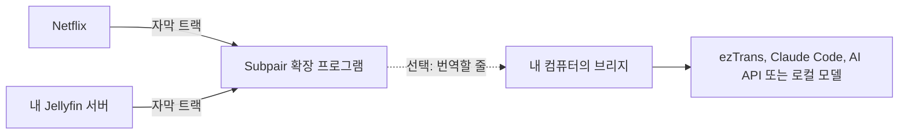
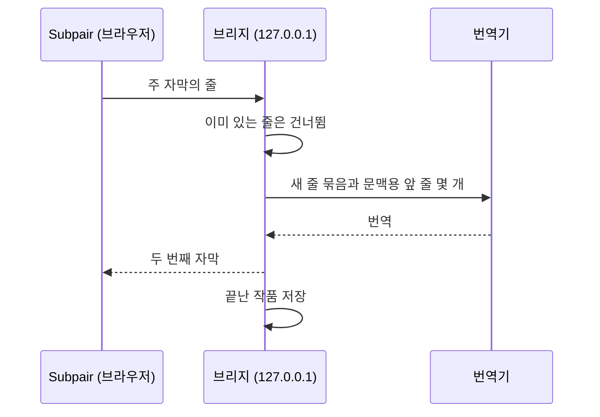

# Subpair

[English](README.md) | 한국어 | [日本語](README.ja.md)

**Netflix와 내 Jellyfin 라이브러리에서 쓰는, Language Reactor의 무료 오픈 소스 대안입니다.** Subpair는 배우고 있는
언어와 내 언어, 자막 두 줄을 동시에 보여 주며 한 줄 다시 듣기, 자동 일시정지, 대본 패널, 클릭할 수 있는 단어를
지원합니다.

- **무료, MIT 라이선스**: 계정도, 추적도 없습니다.
- Netflix뿐 아니라 **내 Jellyfin 라이브러리**도 지원합니다.
- **번역**: 작품에 내 언어 자막이 없으면 컴퓨터에서 실행하는 작은 도우미 프로그램이 번역합니다. Claude, 모든 OpenAI
  호환 모델, 로컬 모델 또는 오프라인 ezTrans를 사용합니다. 번역은 저장되어 다시 쓰이고, 다음 화는 미리 번역되며,
  Jellyfin에서는 한 시즌 전체를 한 번에 번역합니다.
- **일본어 단어 색 구분**과 Yomitan을 이용한 클릭 한 번 검색.
- **영어, 한국어, 일본어** 인터페이스.

**웹사이트: [wonjoonseol-ws.github.io/subpair/ko](https://wonjoonseol-ws.github.io/subpair/ko/)**


## 동작 방식



확장 프로그램은 재생 중인 영상의 자막 트랙을 읽어 그중 두 개를 보여 줍니다. 내 언어 트랙이 없으면 컴퓨터에서
실행하는 작은 Node.js 프로그램인 **브리지**(선택 사항)가 주 자막을 번역하고 결과를 저장합니다.

## 설치

**브라우저 스토어에서**(심사 중):
[Chrome 웹 스토어](https://chromewebstore.google.com/detail/ffohiiambkeeinlkdknkfnnnbpnfbpae),
[Firefox 부가 기능](https://addons.mozilla.org/firefox/addon/subpair/). 승인되기 전까지는 릴리스에서 설치하세요.

**릴리스에서**: [최신 릴리스](https://github.com/wonjoonSeol-WS/subpair/releases/latest)에서 내 브라우저용 zip을
내려받습니다.

1. Chrome, Edge, Brave: `subpair-chrome-<버전>.zip`의 압축을 풀고 `chrome://extensions`(Edge는 `edge://extensions`)를
   연 다음, **개발자 모드**를 켜고 **압축해제된 확장 프로그램을 로드합니다**를 클릭해 압축을 푼 폴더를 선택합니다.
2. Firefox: `about:debugging#/runtime/this-firefox`를 열고 **임시 부가 기능 로드**를 클릭한 다음
   `subpair-firefox-<버전>.zip`을 선택합니다(아직 서명되지 않은 파일이라 Firefox를 다시 시작하기 전까지만 유지됩니다).

**소스에서**(Chrome 111+, Edge, Brave, Firefox 128+):

1. 이 저장소를 내려받거나 클론합니다.
2. Chrome 또는 Edge: `chrome://extensions`(Edge는 `edge://extensions`)를 열고 **개발자 모드**를 켠 다음,
   **압축해제된 확장 프로그램을 로드합니다**를 클릭해 이 폴더를 선택합니다.
   Firefox: `npm run build:firefox`를 실행하고 `about:debugging#/runtime/this-firefox`를 열어
   **임시 부가 기능 로드**를 클릭한 다음 `dist/firefox/manifest.json`을 선택합니다(Firefox를 다시 시작하기 전까지만
   유지됩니다).

## 처음 실행하기

1. 설정 페이지가 자동으로 열립니다. **주 자막**(배우고 있는 언어)과 **두 번째 자막**(내 언어, 브라우저 언어가 미리
   선택되어 있음)을 고른 다음 **설정 저장**을 누릅니다.
2. **Netflix**: 설치한 뒤 Netflix 탭을 한 번 새로고침하고 작품을 재생합니다.
3. **Jellyfin**: 서버의 웹 클라이언트를 열고 브라우저 툴바의 Subpair 버튼을 한 번 누릅니다(버튼이 보이지 않으면
   확장 프로그램 메뉴에서 고정하세요). 주소가 `localhost`나 `127.0.0.1`이 아니면 브라우저가 먼저 그 서버를 허용할지
   묻습니다. 설정의 **Jellyfin 서버**에서 주소를 추가해도 됩니다. 그다음 텍스트 자막이 있는 항목을 재생합니다.

| 키 | 동작 |
|---|---|
| `A` / `R` / `D` | 이전 줄 / 현재 줄 반복 / 다음 줄 |
| `Q` | 줄이 끝날 때마다 자동 일시정지 |
| 클릭 / Ctrl+클릭 / Alt+클릭 | 단어 / 기본형 / 줄 전체 복사 |
| Alt+Shift+S 또는 툴바 버튼 | Subpair 켜기/끄기(사이트 자체 자막이 다시 나타남) |

영상 위의 톱니바퀴 버튼으로 보고 있는 영상의 언어, 번역기, 싱크, 크기, 위치, 배경을 바꿀 수 있습니다. 키는 설정에서
바꿀 수 있습니다.

## 번역(선택 사항)

작품에 두 번째 자막 언어의 트랙이 없으면 **브리지**(번역 도우미, `bridge/`에 있는 작은 Node.js 프로그램)가 주 자막을
번역합니다. 누구나 따라 할 수 있는 단계별 안내(Windows의 ezTrans부터)는
[번역 페이지](https://wonjoonseol-ws.github.io/subpair/ko/translation.html)에 있습니다. 요약하면 다음과 같습니다.

1. [Node.js](https://nodejs.org/) 21 이상을 설치합니다. 브리지는 Node 내장 모듈만 쓰므로 `npm install`이 필요
   없습니다.
2. 실행합니다. Windows에서는 `start-bridge.cmd`를 더블클릭하고, 어디서든 `npm run bridge`(`node bridge/server.mjs`와
   같음)로 실행할 수 있습니다. 확장 프로그램의 기본 브리지 주소인 `http://127.0.0.1:8765`에서 연결을 받습니다.
3. 번역기를 설정하고([번역 도우미 설정](#번역-도우미-설정)) `http://127.0.0.1:8765/health`를 확인한 다음, Subpair
   설정이나 톱니바퀴 메뉴에서 번역기를 고릅니다.

문제가 생기면 [docs/ko/troubleshooting.md](docs/ko/troubleshooting.md)를 참고하세요.

## 추천: Yomitan

[Yomitan](https://yomitan.wiki/)의 클립보드 모니터를 켜면 Subpair에서 클릭하는 단어마다 찾아 줍니다. 또는 단어
위에서 Shift를 누르고 있으면 Yomitan 팝업이 뜹니다.


## 지원 플랫폼

| | Windows | macOS | Linux |
|---|---|---|---|
| 확장 프로그램 | 지원 | 지원 | 지원 |
| Claude Code, AI API 또는 로컬 모델을 쓰는 브리지 | 지원 | 지원 | 지원 |
| ezTrans | 지원 | 미지원 | 미지원 |

작성자는 Windows에서만 테스트했습니다.

## 개인정보 보호

번역을 켜지 않는 한 어떤 데이터도 컴퓨터 밖으로 나가지 않습니다. 번역을 켜면 자막 줄이 `127.0.0.1`의 브리지로 가고,
거기서 선택한 번역기로 전달됩니다. Subpair는 사용하도록 설정한 Jellyfin 서버에서만 동작합니다. 전체 내용은
[개인정보 처리방침](https://wonjoonseol-ws.github.io/subpair/ko/privacy.html)에 있습니다.

## 번역 도우미 설정

브리지는 번역한 줄과 끝난 작품을 모두 보관하므로 같은 번역에 비용을 두 번 내지 않으며, 이미 본 작품은 바로
불러옵니다.



### 설정 파일

브리지는 우선순위가 낮은 것부터 다음 순서로 설정을 읽습니다.

1. `bridge/config.defaults.json`: 모든 설정과 기본값입니다(코드의 일부이므로 수정하지 마세요).
2. `bridge/config.json`: 직접 바꾼 설정입니다. `bridge/config.example.json`에서 시작하세요. API 키가 들어갈 수
   있으므로 git에서 무시됩니다.
3. 환경 변수: `BRIDGE_PORT`, `BRIDGE_STORE`, `ANTHROPIC_API_KEY`, `OPENAI_API_KEY`.

기본값 파일에 없는 설정 이름은 오류로 처리되므로, 오타가 있어도 조용히 무시되는 일이 없습니다. 설정이나 환경 변수를
바꾼 뒤에는 브리지를 다시 시작하세요.

### 번역기

| 번역기 | 키 | 설정 방법 |
|---|---|---|
| ezTrans | 없음 | Windows 전용, 일본어에서 한국어로. [ezTrans](#eztrans)를 참고하세요. |
| Claude (`claude -p`) | 없음 | [Claude Code](https://claude.com/claude-code)를 설치하고, 브리지를 실행하는 사용자와 같은 사용자로 `claude`를 한 번 실행해 로그인합니다. 번역은 Claude 요금제 사용량에 포함됩니다. |
| Anthropic API | `ANTHROPIC_API_KEY` 또는 `api.key` | 기본 모델은 `claude-haiku-5-5`입니다. |
| OpenAI 호환(OpenAI, Gemini, DeepSeek, Ollama, LM Studio 등) | `OPENAI_API_KEY` 또는 `openai.key` | `openai.baseUrl`과 `openai.model`을 설정합니다. 내 컴퓨터나 로컬 네트워크의 서버는 보통 키가 필요 없습니다. |

`claude` 명령은 셸 없이 실행됩니다. Windows에서는 Claude Code를 네이티브 설치 프로그램으로 설치하거나(PATH에 있는
`.exe`), `claude.command`를 `claude.exe`의 전체 경로로 설정하세요.

Gemini의 OpenAI 호환 엔드포인트를 쓰는 `bridge/config.json` 예시:

```json
{
  "openai": {
    "baseUrl": "https://generativelanguage.googleapis.com/v1beta/openai",
    "model": "<a Gemini model name>"
  }
}
```

로컬 [Ollama](https://ollama.com/)의 경우:

```json
{ "openai": { "baseUrl": "http://127.0.0.1:11434/v1", "model": "<the model you pulled>" } }
```

키는 브리지를 시작하는 터미널이나 서비스에 설정합니다.

| 시스템 | 이번 세션만 | 영구 |
|---|---|---|
| Windows PowerShell | `$env:OPENAI_API_KEY = "<key>"; npm run bridge` | `setx OPENAI_API_KEY "<key>"` 실행 후 새 터미널 열기 |
| macOS, Linux (bash, zsh) | `OPENAI_API_KEY="<key>" npm run bridge` | `~/.zshrc` 또는 `~/.bashrc`에 `export OPENAI_API_KEY="<key>"` 추가 |

launchd(macOS)나 systemd(Linux)가 시작하는 서비스는 셸 프로필을 읽지 않습니다. 키를 `bridge/config.json`이나 서비스
정의에 넣으세요.

### ezTrans

ezTrans XP는 일본어를 한국어로 번역하는 Windows 프로그램입니다. Subpair에 포함되어 있지 않으므로 직접 설치하세요.
브리지는 LunaTranslator의 32비트 헬퍼를 통해 ezTrans XP와 통신하며, 이 헬퍼는 `bridge/vendor/lunatranslator`에
Subpair와 함께 들어 있습니다(GPL-3.0, LunaTranslator 공식 릴리스에서 가져온 것이며 소스와 버전은 그 폴더의 README에
있습니다).

브리지는 ezTrans XP 폴더를 스스로 찾습니다. 다음 중 엔진(`J2KEngine.dll`)이 있는 첫 번째 폴더를 씁니다.

1. `bridge/config.json`의 `eztrans.dir`
2. ezTrans XP가 현재 사용자에게 기록해 둔 폴더(레지스트리 `HKEY_CURRENT_USER\Software\ChangShin\ezTrans`의
   `FilePath` 값)
3. Program Files (x86), 그다음 Program Files 아래의 `ChangShinSoft\ezTrans XP`

브리지는 시작할 때 사용하는 폴더를 알려 줍니다. 폴더를 직접 지정하려면:

```json
{ "eztrans": { "dir": "D:/Apps/ezTrans XP" } }
```

함께 들어 있는 헬퍼 대신 직접 준비한 헬퍼를 쓰려면 `eztrans.helper`에 그 전체 경로를 설정하세요(다른 작업 폴더가
필요하면 `eztrans.cwd`도 설정합니다). macOS와 Linux에서는 ezTrans를 쓸 수 없으니 다른 번역기를 쓰세요.

### 모델

Subpair 설정에는 번역기마다 **모델** 칸이 있습니다. 비워 두면 브리지의 기본값을 쓰며, 브리지가 실행 중일 때는 그
값이 회색으로 표시됩니다. 이 브리지를 쓰는 모든 사용자의 기본값을 바꾸려면 `bridge/config.json`에 설정합니다. 예:

```json
{ "claude": { "model": "sonnet" } }
```

모델 이름에는 영문자, 숫자, `. : / - _`를 쓸 수 있습니다. 모델마다 번역이 따로 저장되므로 모델을 바꿔도 번역이
섞이지 않습니다.

### 줄을 보내는 방식

- **ezTrans**는 영상보다 몇 줄 앞서 한 줄씩 번역합니다.
- **언어 모델**에는 최대 40줄을 번호를 매긴 목록으로 묶어 보내고, 묶음 앞의 6줄을 문맥으로 함께 보냅니다. 작품
  전체는 여러 묶음으로 나누며, 이미 번역한 줄(또는 반복되는 줄)은 건너뛰고, 한 번에 2개 묶음(Anthropic API는
  3개)을 실행합니다. 잘못된 결과가 돌아온 묶음은 반으로 나누어 다시 시도하며, 그래도 실패한 한 줄은 작품 전체를
  실패로 만드는 대신 그 줄만 빠집니다.

번역기별로 `bridge/config.json`에서 `batch`, `context`, `concurrency`, `timeoutMs`를 바꿀 수 있습니다.

### 비용

Anthropic API와 Claude Haiku 5.5(`claude-haiku-5-5`, 기본값)로 약 300줄짜리 애니메이션 한 화를 번역할 때의 대략적인
비용입니다. 요금은 10만 토큰 미만 요청 기준 입력 100만 토큰당 $0.10(약 130원), 출력 100만 토큰당 $0.50(약 670원)이고
([Anthropic 요금](https://www.anthropic.com/pricing)), 2026년 10월 환율 1달러 약 1,330원으로 환산했습니다.

| | 한 화 | 12화 시즌 |
|---|---|---|
| 요청 | 약 8회(40줄 묶음) | 약 96회 |
| 입력 | 요청당 약 1,500토큰 | |
| 출력 | 요청당 약 1,200~2,000토큰 | |
| **비용** | **약 8~13원** | **약 90~160원**(재시도 포함 시 400원 미만) |

이 값은 측정값이 아닌 추정치입니다. 일본어나 한국어 한 글자당 약 1토큰, 요청마다 250토큰 분량의 지시문과 문맥 6줄,
`api.effort`를 `low`로 설정한 경우를 가정했습니다. 이미 번역한 줄에는 다시 비용이 들지 않습니다. Claude
번역기(`claude -p`)는 토큰당 과금 대신 Claude 요금제를 사용하며, ezTrans와 로컬 모델은 줄마다 드는 비용이 없습니다.

### 저장된 번역

끝난 작품은 브리지의 데이터 폴더에 저장됩니다. Windows는 `%LOCALAPPDATA%\subpair`,
macOS는 `~/Library/Application Support/subpair`,
Linux는 `$XDG_DATA_HOME/subpair` 또는 `~/.local/share/subpair`입니다(`storeDir` 또는 `BRIDGE_STORE`로 바꿀 수 있습니다).

Jellyfin에서는 끝난 번역을 그 항목의 외부 자막 트랙으로도 추가합니다(`POST /Videos/{itemId}/Subtitles`, Jellyfin이 영상
옆에 `<영상 이름>.<언어>.srt`로 저장). 그래서 모든 Jellyfin 앱에서 보입니다. 항목에 그 언어의 자막이 없을 때만
추가하며, 계정에 자막 관리 권한이 필요합니다. 미리 번역한 화(다음 화, 시즌 전체)도 같은 방식으로 추가합니다.
**이 작품 다시 번역**은 Subpair가 이전에 추가한 트랙을 바꿉니다(삭제에는 관리자 권한 필요). Subpair가 만들지 않은
트랙은 절대 바꾸거나 지우지 않습니다.

### 시작 시 브리지 실행

**Windows**: `scripts\windows\autostart-on.cmd`를 더블클릭합니다. 시작프로그램 폴더에 바로 가기를 만들어 로그인할
때마다 `scripts\windows\run-bridge.ps1`을 숨김 상태로 실행하고(관리자 권한 불필요), 지금도 바로 시작합니다.
`autostart-off.cmd`는 바로 가기를 지우고 그 브리지를 멈춥니다.

`run-bridge.ps1`은 브리지가 멈추면 다시 시작하고(5초 기다리고, 대기 시간을 두 배씩 늘려 최대 60초까지, 빠른 실패가
연속 8번이면 포기), 포트마다 하나만 실행되도록 하며, 그 포트에 남아 있던 브리지를 멈추고, 출력을 로그(기본값
`%LOCALAPPDATA%\subpair\bridge.log`)에 이어 씁니다. 옵션은 `-Port`, `-Log`, `-Repo`, `-Node`, `-MaxQuickFailures`입니다.

개발용 브리지와 함께 항상 실행해 둘 브리지는 8777처럼 다른 포트를 쓰고, 확장 프로그램의 **브리지 주소**도 같은 포트로
설정하세요. 로그온할 때 시작하고 5분마다 확인하는 작업으로 작업 스케줄러에 등록하려면(PowerShell, 저장소 폴더에서
실행):

```powershell
$script   = (Resolve-Path 'scripts\windows\run-bridge.ps1').Path
$action   = New-ScheduledTaskAction -Execute 'powershell.exe' -Argument "-WindowStyle Hidden -NoProfile -ExecutionPolicy Bypass -File `"$script`" -Port 8777"
$triggers = @(
  New-ScheduledTaskTrigger -AtLogOn -User "$env:USERDOMAIN\$env:USERNAME"
  New-ScheduledTaskTrigger -Once -At (Get-Date).Date -RepetitionInterval (New-TimeSpan -Minutes 5)
)
$settings = New-ScheduledTaskSettingsSet -ExecutionTimeLimit (New-TimeSpan -Seconds 0) -MultipleInstances IgnoreNew -AllowStartIfOnBatteries -DontStopIfGoingOnBatteries
Register-ScheduledTask -TaskName 'Subpair bridge' -Action $action -Trigger $triggers -Settings $settings
Start-ScheduledTask -TaskName 'Subpair bridge'
```

`Invoke-RestMethod http://127.0.0.1:8777/health`로 확인합니다. 완전히 멈추려면
`Unregister-ScheduledTask -TaskName 'Subpair bridge'`를 실행한 다음, `bridge\server.mjs`를 실행 중인 `node` 프로세스를
종료합니다.

**macOS**(테스트하지 않음): 다음 내용을 `~/Library/LaunchAgents/com.subpair.bridge.plist`로 저장합니다. 경로는 내
환경에 맞게 바꾸세요(Node 경로는 `which node`로 확인할 수 있습니다).

```xml
<?xml version="1.0" encoding="UTF-8"?>
<!DOCTYPE plist PUBLIC "-//Apple//DTD PLIST 1.0//EN" "http://www.apple.com/DTDs/PropertyList-1.0.dtd">
<plist version="1.0">
<dict>
  <key>Label</key><string>com.subpair.bridge</string>
  <key>ProgramArguments</key>
  <array><string>/opt/homebrew/bin/node</string><string>/path/to/subpair/bridge/server.mjs</string></array>
  <key>RunAtLoad</key><true/>
  <key>KeepAlive</key><true/>
  <key>StandardOutPath</key><string>/tmp/subpair-bridge.log</string>
  <key>StandardErrorPath</key><string>/tmp/subpair-bridge.log</string>
</dict>
</plist>
```

그다음 `launchctl bootstrap gui/$(id -u) ~/Library/LaunchAgents/com.subpair.bridge.plist`를 실행합니다.

**Linux**(테스트하지 않음): 다음 내용을 `~/.config/systemd/user/subpair-bridge.service`로 저장합니다.

```ini
[Unit]
Description=Subpair translation bridge

[Service]
ExecStart=/usr/bin/node /path/to/subpair/bridge/server.mjs
Restart=on-failure

[Install]
WantedBy=default.target
```

그다음 `systemctl --user enable --now subpair-bridge`를 실행합니다.

### Subpair만 허용하기

기본적으로 이 컴퓨터의 모든 브라우저 확장 프로그램이 브리지를 호출할 수 있으며, 브리지는 시작할 때 이를 알려 줍니다.
Subpair만 허용하려면 `bridge/config.json`에 Subpair의 출처를 추가하고 브리지를 다시 시작하세요.

```json
{ "allowedOrigins": ["chrome-extension://<the ID shown on chrome://extensions>"] }
```

Firefox에서는 `moz-extension://<about:debugging#/runtime/this-firefox에 표시되는 내부 UUID>`를 사용합니다. 확장 프로그램을
다른 폴더에서 불러오면 ID가 바뀌며, ID를 새로 넣을 때까지 브리지는 "허용되지 않은 출처"라고 응답합니다.

## 기여와 라이선스

[CONTRIBUTING.md](CONTRIBUTING.md)를 참고하세요. MIT 라이선스입니다. `vendor/kuromoji`는 Apache-2.0,
`bridge/vendor/lunatranslator`(ezTrans 헬퍼)는 GPL-3.0입니다. Netflix, Jellyfin, Language Reactor와 제휴 관계가
없습니다.
