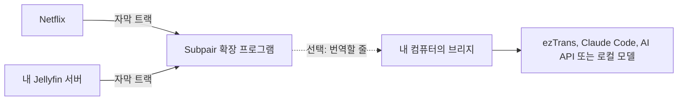

# Subpair

[English](README.md) | 한국어 | [日本語](README.ja.md)

**Netflix와 내 Jellyfin 라이브러리에서 쓰는, Language Reactor의 무료 오픈 소스 대안입니다.** Subpair는 배우고 있는
언어와 내 언어, 자막 두 줄을 동시에 보여 주며 한 줄 다시 듣기, 자동 일시정지, 대본 패널, 클릭할 수 있는 단어를
지원합니다.

- **무료, MIT 라이선스**: 계정도, 추적도 없습니다.
- Netflix뿐 아니라 **내 Jellyfin 라이브러리**도 지원합니다.
- **번역**: 작품에 내 언어 자막이 없으면 컴퓨터에서 실행하는 작은 도우미 프로그램이 번역합니다. Claude, 모든 OpenAI
  호환 모델, 로컬 모델 또는 오프라인 ezTrans를 사용합니다. 번역은 저장되어 다시 쓰이고, 다음 화는 미리 번역되며,
  Jellyfin에서는 한 시즌 전체를 한 번에 번역합니다.
- **일본어 단어 색 구분**과 Yomitan을 이용한 클릭 한 번 검색.
- **영어, 한국어, 일본어** 인터페이스.

**웹사이트: [wonjoonseol-ws.github.io/subpair/ko](https://wonjoonseol-ws.github.io/subpair/ko/)**

## 동작 방식

확장 프로그램은 재생 중인 영상의 자막 트랙을 읽어 그중 두 개를 보여 줍니다. 내 언어 트랙이 없으면 컴퓨터에서
실행하는 작은 Node.js 프로그램인 **브리지**(선택 사항)가 주 자막을 번역하고 결과를 저장합니다.

## 설치

**브라우저 스토어에서**: Chrome Web Store와 Firefox Add-ons 등록은 곧 공개됩니다.

**소스에서**(Chrome 111+, Edge, Brave, Firefox 128+):

1. 이 저장소를 내려받거나 클론합니다.
2. Chrome 또는 Edge: `chrome://extensions`(Edge는 `edge://extensions`)를 열고 **개발자 모드**를 켠 다음,
   **압축해제된 확장 프로그램을 로드합니다**를 클릭해 이 폴더를 선택합니다.
   Firefox: `npm run build:firefox`를 실행하고 `about:debugging#/runtime/this-firefox`를 열어
   **임시 부가 기능 로드**를 클릭한 다음 `dist/firefox/manifest.json`을 선택합니다(Firefox를 다시 시작하기 전까지만
   유지됩니다).

## 처음 실행하기

1. 설정 페이지가 자동으로 열립니다. **주 자막**(배우고 있는 언어)과 **두 번째 자막**(내 언어, 브라우저 언어가 미리
   선택되어 있음)을 고른 다음 **설정 저장**을 누릅니다.
2. **Netflix**: 설치한 뒤 Netflix 탭을 한 번 새로고침하고 작품을 재생합니다.
3. **Jellyfin**: 서버의 웹 클라이언트를 열고 브라우저 툴바의 Subpair 버튼을 한 번 누릅니다(버튼이 보이지 않으면
   확장 프로그램 메뉴에서 고정하세요). 주소가 `localhost`나 `127.0.0.1`이 아니면 브라우저가 먼저 그 서버를 허용할지
   묻습니다. 설정의 **Jellyfin 서버**에서 주소를 추가해도 됩니다. 그다음 텍스트 자막이 있는 항목을 재생합니다.

| 키 | 동작 |
|---|---|
| `A` / `R` / `D` | 이전 줄 / 현재 줄 반복 / 다음 줄 |
| `Q` | 줄이 끝날 때마다 자동 일시정지 |
| 클릭 / Ctrl+클릭 / Alt+클릭 | 단어 / 기본형 / 줄 전체 복사 |
| Alt+Shift+S 또는 툴바 버튼 | Subpair 켜기/끄기(사이트 자체 자막이 다시 나타남) |

영상 위의 톱니바퀴 버튼으로 보고 있는 영상의 언어, 번역기, 싱크, 크기, 위치, 배경을 바꿀 수 있습니다. 키는 설정에서
바꿀 수 있습니다.

## 번역(선택 사항)

1. [Node.js](https://nodejs.org/) 21 이상을 설치하고 이 폴더에서 `npm install`을 실행합니다.
2. `bridge/config.example.json`을 `bridge/config.json`으로 복사하고 번역기 하나를 설정합니다.

   | 번역기 | 필요한 것 |
   |---|---|
   | ezTrans(Windows, 일본어에서 한국어) | ezTrans XP 설치, `eztrans.dir` 설정 |
   | Claude Code (`claude -p`) | Claude Code 설치와 로그인. Claude 요금제를 사용합니다 |
   | Anthropic API | `ANTHROPIC_API_KEY` 또는 `api.key` |
   | OpenAI 호환(OpenAI, Gemini, DeepSeek, Ollama, LM Studio 등) | `openai.baseUrl`, `openai.model`, 호스팅 서비스라면 키 |

3. `npm run bridge`를 실행합니다(확장 프로그램의 기본 브리지 주소인 `http://127.0.0.1:8765`에서 연결을 받습니다).
4. `http://127.0.0.1:8765/health`를 확인한 다음, Subpair 설정이나 톱니바퀴 메뉴에서 번역기와 번역 시점을 고릅니다.

모델, 비용(Claude Haiku로 한 화에 약 $0.01), 키, Windows, macOS, Linux에서 시작 시 브리지 실행, Subpair만 쓰도록
제한하는 방법(`allowedOrigins`)은 [docs/ko/translation.md](docs/ko/translation.md)에 있습니다.
문제가 생기면 [docs/ko/troubleshooting.md](docs/ko/troubleshooting.md)를 참고하세요.

## 추천: Yomitan

[Yomitan](https://yomitan.wiki/)의 클립보드 모니터를 켜면 Subpair에서 클릭하는 단어마다 찾아 줍니다. 또는 단어
위에서 Shift를 누르고 있으면 Yomitan 팝업이 뜹니다.

## 지원 플랫폼

| | Windows | macOS | Linux |
|---|---|---|---|
| 확장 프로그램 | 지원 | 지원 | 지원 |
| Claude Code, AI API 또는 로컬 모델을 쓰는 브리지 | 지원 | 지원 | 지원 |
| ezTrans | 지원 | 미지원 | 미지원 |

작성자는 Windows에서만 테스트했습니다.

## 개인정보 보호

번역을 켜지 않는 한 어떤 데이터도 컴퓨터 밖으로 나가지 않습니다. 번역을 켜면 자막 줄이 `127.0.0.1`의 브리지로 가고,
거기서 선택한 번역기로 전달됩니다. Subpair는 사용하도록 설정한 Jellyfin 서버에서만 동작합니다. 전체 내용은
[개인정보 처리방침](https://wonjoonseol-ws.github.io/subpair/ko/privacy.html)에 있습니다.

## 기여와 라이선스

[CONTRIBUTING.md](CONTRIBUTING.md)를 참고하세요. MIT 라이선스입니다. `vendor/kuromoji`는 Apache-2.0,
`bridge/vendor/lunatranslator`(ezTrans 헬퍼)는 GPL-3.0입니다. Netflix, Jellyfin, Language Reactor와 제휴 관계가
없습니다.
