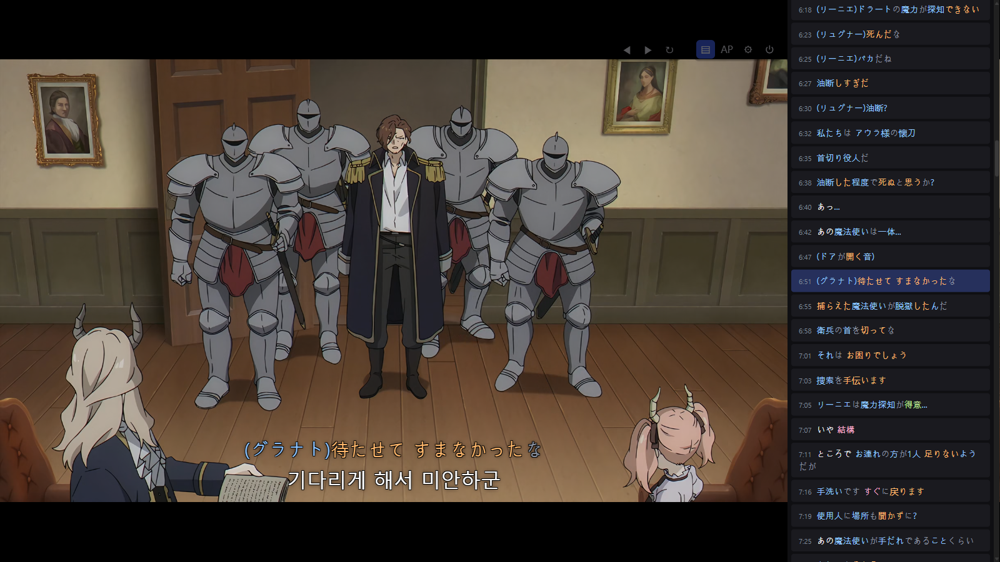
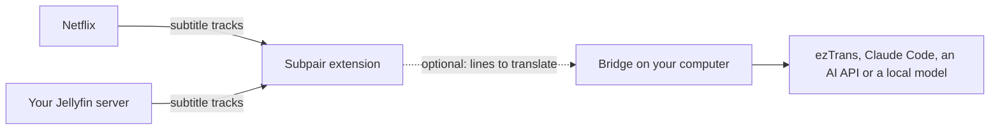
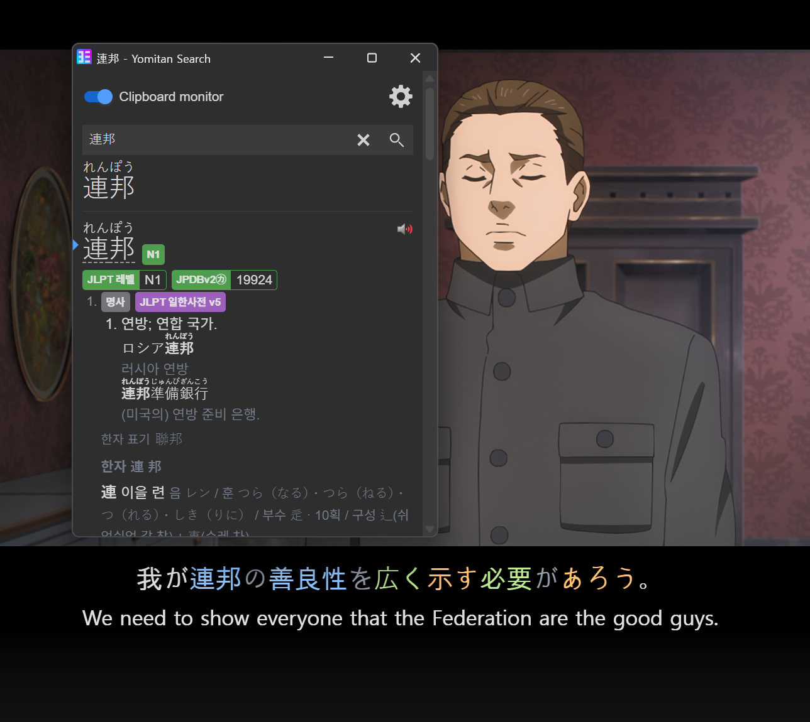
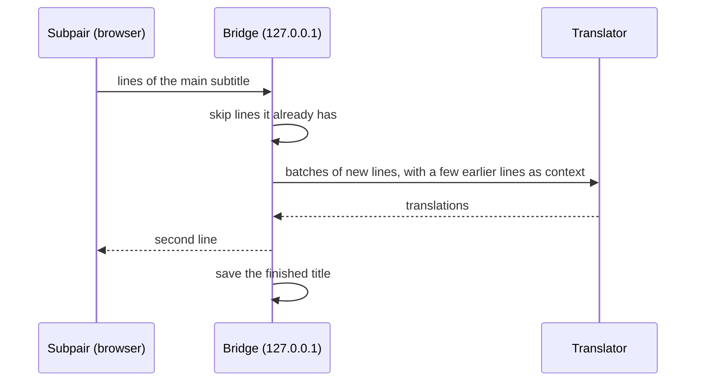

# Subpair

English | [한국어](README.ko.md) | [日本語](README.ja.md)

**A free, open-source alternative to Language Reactor, for Netflix and your own Jellyfin library.** Subpair shows two
subtitle lines at once, the language you are learning and your own, with line replay, auto-pause, a transcript panel
and clickable words.

- **Free and MIT-licensed**: no account, no tracking.
- **Your own Jellyfin library**, not only Netflix.
- **Translation** when a show has no subtitles in your language, through a small helper on your computer: Claude, any
  OpenAI-compatible model, a local model or offline ezTrans. Translations are saved and reused, the next episode is translated ahead, and on
  Jellyfin a whole season at once.
- **Japanese word colors** and one-click lookup with Yomitan.
- **English, Korean and Japanese** interface.

**Website: [wonjoonseol-ws.github.io/subpair](https://wonjoonseol-ws.github.io/subpair/)**



## How it works



The extension reads the subtitle tracks of what you are playing and shows two of them. When your language has no track,
the optional **bridge**, a small Node.js program on your computer, translates the main line and saves the result.

## Install

**From the browser stores** (in review):
[Chrome Web Store](https://chromewebstore.google.com/detail/ffohiiambkeeinlkdknkfnnnbpnfbpae),
[Firefox Add-ons](https://addons.mozilla.org/firefox/addon/subpair/). Until they are approved, install a release:

**From a release**: download the zip for your browser from the
[latest release](https://github.com/wonjoonSeol-WS/subpair/releases/latest).

1. Chrome, Edge or Brave: unzip `subpair-chrome-<version>.zip`, open `chrome://extensions` (Edge: `edge://extensions`),
   switch on **Developer mode**, click **Load unpacked** and pick the unzipped folder.
2. Firefox: open `about:debugging#/runtime/this-firefox`, click **Load Temporary Add-on** and pick
   `subpair-firefox-<version>.zip` (the file is not signed yet, so it stays until Firefox restarts).

**From source** (Chrome 111+, Edge, Brave; Firefox 128+):

1. Download or clone this repository.
2. Chrome or Edge: open `chrome://extensions` (Edge: `edge://extensions`), switch on **Developer mode**, click
   **Load unpacked** and pick this folder.
   Firefox: run `npm run build:firefox`, open `about:debugging#/runtime/this-firefox`, click
   **Load Temporary Add-on** and pick `dist/firefox/manifest.json` (temporary until Firefox restarts).

## First run

1. The settings page opens by itself: choose the **main line** (the language you are learning) and the **second line**
   (yours; your browser's language is pre-selected), then **Save settings**.
2. **Netflix**: reload the Netflix tab once after installing, then play a title.
3. **Jellyfin**: open your server's web client and click the Subpair button in the browser toolbar once (pin it from the
   extensions menu if it is hidden). Unless the address is `localhost` or `127.0.0.1`, the browser asks you to allow that
   server first. You can also add the address under **Jellyfin servers** in the settings. Then play an item with text
   subtitles.

| Key | Action |
|---|---|
| `A` / `R` / `D` | previous / repeat / next line |
| `Q` | auto-pause at the end of every line |
| click / Ctrl+click / Alt+click | copy a word / its dictionary form / the whole line |
| Alt+Shift+S, or the toolbar button | turn Subpair on or off (the sites' own subtitles come back) |

The gear button on the video changes languages, translator, timing, size, position and background for the video you
are watching. Keys can be changed in the settings.

## Translation (optional)

When a title has no subtitle in your second-line language, the **bridge** (the translation helper in `bridge/`, a small
Node.js program) translates the main line. The step-by-step guide for everyone, starting with ezTrans on Windows, is the
[Translation page](https://wonjoonseol-ws.github.io/subpair/translation.html). In short:

1. Install [Node.js](https://nodejs.org/) 21 or newer. The bridge uses only Node's own modules, so it needs no
   `npm install`.
2. Start it: double-click `start-bridge.cmd` on Windows, or run `npm run bridge` (the same as `node bridge/server.mjs`).
   It listens on `http://127.0.0.1:8765`, the extension's default bridge address.
3. Set up a translator ([Bridge setup](#bridge-setup)), check `http://127.0.0.1:8765/health`, and pick the translator in
   the Subpair settings or the gear menu.

Problems: [docs/troubleshooting.md](docs/troubleshooting.md).

## Suggested: Yomitan

Turn on [Yomitan](https://yomitan.wiki/)'s clipboard monitor and every word you click in Subpair is looked up, or hold
Shift over a word for Yomitan's pop-up.



## Platforms

| | Windows | macOS | Linux |
|---|---|---|---|
| Extension | yes | yes | yes |
| Bridge with Claude Code, an AI API or a local model | yes | yes | yes |
| ezTrans | yes | no | no |

Only Windows is tested by the author.

## Privacy

Nothing leaves your computer unless you turn on translation: then subtitle lines go to the bridge on `127.0.0.1` and on to
the translator you chose. Subpair runs only on the Jellyfin servers you enable. Full
[privacy policy](https://wonjoonseol-ws.github.io/subpair/privacy.html).

## Bridge setup

The bridge keeps every translated line and every finished title, so nothing is paid for twice and a title you have
watched loads at once.



### Settings files

The bridge reads, from lowest to highest priority:

1. `bridge/config.defaults.json`: every setting with its default (part of the code; do not edit).
2. `bridge/config.json`: your own changes. Start from `bridge/config.example.json`. It can hold API keys, so it is
   ignored by git.
3. Environment variables: `BRIDGE_PORT`, `BRIDGE_STORE`, `ANTHROPIC_API_KEY`, `OPENAI_API_KEY`.

A setting name that does not exist in the defaults file is an error, so a typo never silently does nothing. Restart the
bridge after changing a setting or an environment variable.

### Translators

| Translator | Key | Setting up |
|---|---|---|
| ezTrans | none | Windows only, Japanese to Korean. See [ezTrans](#eztrans). |
| Claude (`claude -p`) | none | Install [Claude Code](https://claude.com/claude-code) and run `claude` once to log in, as the same user that runs the bridge. Translations count against your Claude plan. |
| Anthropic API | `ANTHROPIC_API_KEY` or `api.key` | The default model is `claude-haiku-5-5`. |
| OpenAI-compatible (OpenAI, Gemini, DeepSeek, Ollama, LM Studio...) | `OPENAI_API_KEY` or `openai.key` | Set `openai.baseUrl` and `openai.model`. Servers on your computer or local network usually need no key. |

The `claude` command is started without a shell. On Windows install Claude Code with its native installer (an `.exe`
on the PATH), or set `claude.command` to the full path of `claude.exe`.

Example `bridge/config.json` for Gemini through its OpenAI-compatible endpoint:

```json
{
  "openai": {
    "baseUrl": "https://generativelanguage.googleapis.com/v1beta/openai",
    "model": "<a Gemini model name>"
  }
}
```

and for a local [Ollama](https://ollama.com/):

```json
{ "openai": { "baseUrl": "http://127.0.0.1:11434/v1", "model": "<the model you pulled>" } }
```

Set a key for the terminal or service that starts the bridge:

| System | This session only | Permanently |
|---|---|---|
| Windows PowerShell | `$env:OPENAI_API_KEY = "<key>"; npm run bridge` | `setx OPENAI_API_KEY "<key>"`, then open a new terminal |
| macOS, Linux (bash, zsh) | `OPENAI_API_KEY="<key>" npm run bridge` | add `export OPENAI_API_KEY="<key>"` to `~/.zshrc` or `~/.bashrc` |

Services started by launchd (macOS) or systemd (Linux) do not read your shell profile: put the key in
`bridge/config.json` or in the service definition.

### ezTrans

ezTrans XP is a Windows Japanese-to-Korean translator. It is not included: install it yourself. The bridge reaches it
through LunaTranslator's 32-bit helper, which ships with Subpair in `bridge/vendor/lunatranslator` (GPL-3.0, from the
official LunaTranslator release; source and version in that folder's README).

The bridge finds the ezTrans XP folder by itself, taking the first of these that holds the engine (`J2KEngine.dll`):

1. `eztrans.dir` in `bridge/config.json`;
2. the folder ezTrans XP recorded for the current user (registry `HKEY_CURRENT_USER\Software\ChangShin\ezTrans`, value
   `FilePath`);
3. `ChangShinSoft\ezTrans XP` under Program Files (x86), then under Program Files.

It prints the folder it uses when it starts. To name the folder yourself:

```json
{ "eztrans": { "dir": "D:/Apps/ezTrans XP" } }
```

To use your own copy of the helper instead, set `eztrans.helper` to its full path (and `eztrans.cwd` if it needs another
working folder). On macOS and Linux ezTrans is not offered; use another translator.

### Models

The Subpair settings have a **model** box per translator. Empty means the bridge's default, shown in grey while the
bridge runs. To change the default for everyone using this bridge, set it in `bridge/config.json`, for example:

```json
{ "claude": { "model": "sonnet" } }
```

A model name may use letters, digits and `. : / - _`. Each model's translations are saved separately, so switching
models never mixes them.

### How lines are sent

- **ezTrans** translates line by line, a few lines ahead of the video.
- The **language models** get batches of up to 40 lines as a numbered list, plus the 6 lines before the batch as
  context. A whole title is split into batches, lines already translated (or repeated) are skipped, and 2 batches run
  at a time (3 for the Anthropic API). A batch that comes back wrong is split in half and tried again; a single line
  that still fails is left out instead of failing the title.

Per translator you can change `batch`, `context`, `concurrency` and `timeoutMs` in `bridge/config.json`.

### Cost

Rough cost of one anime episode of about 300 lines with the Anthropic API and Claude Haiku 5.5 (`claude-haiku-5-5`, the
default; $0.10 per million input tokens and $0.50 per million output tokens for prompts under 100K tokens, as of October
2026, see [Anthropic's pricing](https://www.anthropic.com/pricing)):

| | Per episode | 12-episode season |
|---|---|---|
| Requests | about 8 (batches of 40 lines) | about 96 |
| Input | about 1,500 tokens per request | |
| Output | about 1,200 to 2,000 tokens per request | |
| **Cost** | **about $0.006 to $0.01** | **about $0.07 to $0.12** (under $0.30 with retries) |

These are estimates, not measurements: about one token per Japanese or Korean character, a 250-token instruction
and 6 context lines per request, and `api.effort` set to `low`. Lines already translated are never paid for again.
The Claude translator (`claude -p`) uses your Claude plan instead of per-token billing; ezTrans and local models cost
nothing per line.

### Saved translations

A finished title is saved in the bridge's data folder: `%LOCALAPPDATA%\subpair` on Windows,
`~/Library/Application Support/subpair` on macOS, `$XDG_DATA_HOME/subpair` or `~/.local/share/subpair` on Linux
(`storeDir` or `BRIDGE_STORE` change it).

On Jellyfin, Subpair also adds a finished translation to the item as an external subtitle track
(`POST /Videos/{itemId}/Subtitles`; Jellyfin saves it next to the video as `<video>.<language>.srt`), so every Jellyfin
app shows it. It does so only when the item has no subtitle in that language, and the account needs permission to manage
subtitles. Episodes translated ahead (the next episode, a whole season) are added the same way. **Translate this title
again** replaces the track Subpair added before (deleting it needs an administrator); a track Subpair did not make is
never replaced or deleted.

### Run the bridge at startup

**Windows**: double-click `scripts\windows\autostart-on.cmd`. It puts a shortcut in your Startup folder that runs
`scripts\windows\run-bridge.ps1` hidden at every sign-in (no administrator rights needed), and starts it now.
`autostart-off.cmd` removes the shortcut and stops that bridge.

`run-bridge.ps1` restarts the bridge when it stops (waiting 5 s, doubling up to 60 s, giving up after 8 quick failures
in a row), allows only one copy per port, stops a bridge left running on that port, and appends its output to a log
(default `%LOCALAPPDATA%\subpair\bridge.log`). Its options: `-Port`, `-Log`, `-Repo`, `-Node`, `-MaxQuickFailures`.

To keep an always-on copy next to a development bridge, give it another port, for example 8777, and set the extension's
**Bridge address** to it. As a scheduled task that starts at logon and checks every 5 minutes (PowerShell, from the
repository folder):

```powershell
$script   = (Resolve-Path 'scripts\windows\run-bridge.ps1').Path
$action   = New-ScheduledTaskAction -Execute 'powershell.exe' -Argument "-WindowStyle Hidden -NoProfile -ExecutionPolicy Bypass -File `"$script`" -Port 8777"
$triggers = @(
  New-ScheduledTaskTrigger -AtLogOn -User "$env:USERDOMAIN\$env:USERNAME"
  New-ScheduledTaskTrigger -Once -At (Get-Date).Date -RepetitionInterval (New-TimeSpan -Minutes 5)
)
$settings = New-ScheduledTaskSettingsSet -ExecutionTimeLimit (New-TimeSpan -Seconds 0) -MultipleInstances IgnoreNew -AllowStartIfOnBatteries -DontStopIfGoingOnBatteries
Register-ScheduledTask -TaskName 'Subpair bridge' -Action $action -Trigger $triggers -Settings $settings
Start-ScheduledTask -TaskName 'Subpair bridge'
```

Check it with `Invoke-RestMethod http://127.0.0.1:8777/health`. To stop it for good:
`Unregister-ScheduledTask -TaskName 'Subpair bridge'`, then end the `node` process running `bridge\server.mjs`.

**macOS** (not tested): save as `~/Library/LaunchAgents/com.subpair.bridge.plist`, with your paths (`which node` shows
Node's):

```xml
<?xml version="1.0" encoding="UTF-8"?>
<!DOCTYPE plist PUBLIC "-//Apple//DTD PLIST 1.0//EN" "http://www.apple.com/DTDs/PropertyList-1.0.dtd">
<plist version="1.0">
<dict>
  <key>Label</key><string>com.subpair.bridge</string>
  <key>ProgramArguments</key>
  <array><string>/opt/homebrew/bin/node</string><string>/path/to/subpair/bridge/server.mjs</string></array>
  <key>RunAtLoad</key><true/>
  <key>KeepAlive</key><true/>
  <key>StandardOutPath</key><string>/tmp/subpair-bridge.log</string>
  <key>StandardErrorPath</key><string>/tmp/subpair-bridge.log</string>
</dict>
</plist>
```

Then `launchctl bootstrap gui/$(id -u) ~/Library/LaunchAgents/com.subpair.bridge.plist`.

**Linux** (not tested): save as `~/.config/systemd/user/subpair-bridge.service`:

```ini
[Unit]
Description=Subpair translation bridge

[Service]
ExecStart=/usr/bin/node /path/to/subpair/bridge/server.mjs
Restart=on-failure

[Install]
WantedBy=default.target
```

Then `systemctl --user enable --now subpair-bridge`.

### Allow only Subpair

By default any browser extension on your computer may call the bridge, and the bridge says so when it starts. To allow
only Subpair, add its origin to `bridge/config.json` and restart the bridge:

```json
{ "allowedOrigins": ["chrome-extension://<the ID shown on chrome://extensions>"] }
```

For Firefox use `moz-extension://<the Internal UUID shown on about:debugging#/runtime/this-firefox>`. The ID changes when
the extension is loaded from another folder; the bridge then answers "forbidden origin" until you update it.

## Contributing and license

See [CONTRIBUTING.md](CONTRIBUTING.md). MIT License. `vendor/kuromoji` is Apache-2.0 and
`bridge/vendor/lunatranslator` (ezTrans helper) is GPL-3.0. Not affiliated with Netflix, Jellyfin or Language Reactor.
