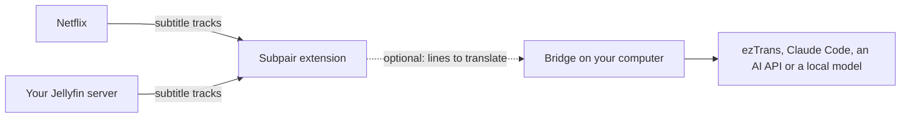

# Subpair

English | [한국어](README.ko.md) | [日本語](README.ja.md)

**A free, open-source alternative to Language Reactor, for Netflix and your own Jellyfin library.** Subpair shows two
subtitle lines at once, the language you are learning and your own, with line replay, auto-pause, a transcript panel
and clickable words.

- **Free and MIT-licensed**: no account, no tracking.
- **Your own Jellyfin library**, not only Netflix.
- **Translation** when a show has no subtitles in your language, through a small helper on your computer: Claude, any
  OpenAI-compatible model, a local model or offline ezTrans. Translations are saved and reused, the next episode is translated ahead, and on
  Jellyfin a whole season at once.
- **Japanese word colors** and one-click lookup with Yomitan.
- **English, Korean and Japanese** interface.

**Website: [wonjoonseol-ws.github.io/subpair](https://wonjoonseol-ws.github.io/subpair/)**

## How it works

The extension reads the subtitle tracks of what you are playing and shows two of them. When your language has no track,
the optional **bridge**, a small Node.js program on your computer, translates the main line and saves the result.

## Install

**From the browser stores**: Chrome Web Store and Firefox Add-ons listings are coming soon.

**From source** (Chrome 111+, Edge, Brave; Firefox 128+):

1. Download or clone this repository.
2. Chrome or Edge: open `chrome://extensions` (Edge: `edge://extensions`), switch on **Developer mode**, click
   **Load unpacked** and pick this folder.
   Firefox: run `npm run build:firefox`, open `about:debugging#/runtime/this-firefox`, click
   **Load Temporary Add-on** and pick `dist/firefox/manifest.json` (temporary until Firefox restarts).

## First run

1. The settings page opens by itself: choose the **main line** (the language you are learning) and the **second line**
   (yours; your browser's language is pre-selected), then **Save settings**.
2. **Netflix**: reload the Netflix tab once after installing, then play a title.
3. **Jellyfin**: open your server's web client, play an item with text subtitles and click **Use Subpair on this
   server?** once.

| Key | Action |
|---|---|
| `A` / `R` / `D` | previous / repeat / next line |
| `Q` | auto-pause at the end of every line |
| click / Ctrl+click / Alt+click | copy a word / its dictionary form / the whole line |
| Alt+Shift+S, or the toolbar button | turn Subpair on or off (the sites' own subtitles come back) |

The gear button on the video changes languages, translator, timing, size, position and background for the video you
are watching. Keys can be changed in the settings.

## Translation (optional)

1. Install [Node.js](https://nodejs.org/) 21 or newer and run `npm install` in this folder.
2. Copy `bridge/config.example.json` to `bridge/config.json` and set up one translator:

   | Translator | Needs |
   |---|---|
   | ezTrans (Windows, Japanese to Korean) | ezTrans XP installed; set `eztrans.dir` |
   | Claude Code (`claude -p`) | Claude Code installed and logged in; uses your Claude plan |
   | Anthropic API | `ANTHROPIC_API_KEY` or `api.key` |
   | OpenAI-compatible (OpenAI, Gemini, DeepSeek, Ollama, LM Studio...) | `openai.baseUrl`, `openai.model`, and a key for hosted services |

3. Run `npm run bridge` (it listens on `http://127.0.0.1:8765`, the extension's default bridge address).
4. Check `http://127.0.0.1:8765/health`, then pick the translator and when to translate in the Subpair settings or in the
   gear menu.

Models, costs (about $0.01 per episode with Claude Haiku), keys, running the bridge at startup on Windows, macOS and
Linux, and limiting it to Subpair (`allowedOrigins`) are in [docs/translation.md](docs/translation.md).
Problems: [docs/troubleshooting.md](docs/troubleshooting.md).

## Suggested: Yomitan

Turn on [Yomitan](https://yomitan.wiki/)'s clipboard monitor and every word you click in Subpair is looked up, or hold
Shift over a word for Yomitan's pop-up.

## Platforms

| | Windows | macOS | Linux |
|---|---|---|---|
| Extension | yes | yes | yes |
| Bridge with Claude Code, an AI API or a local model | yes | yes | yes |
| ezTrans | yes | no | no |

Only Windows is tested by the author.

## Privacy

Nothing leaves your computer unless you turn on translation: then subtitle lines go to the bridge on `127.0.0.1` and on to
the translator you chose. Subpair asks before it works on a Jellyfin server. Full
[privacy policy](https://wonjoonseol-ws.github.io/subpair/privacy.html).

## Contributing and license

See [CONTRIBUTING.md](CONTRIBUTING.md). MIT License. `vendor/kuromoji` is Apache-2.0 and
`bridge/vendor/lunatranslator` (ezTrans helper) is GPL-3.0. Not affiliated with Netflix, Jellyfin or Language Reactor.
