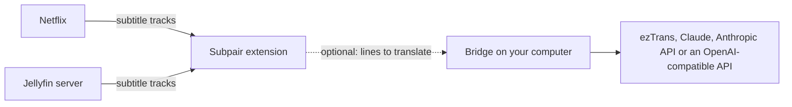

# Set up Subpair

Subpair shows two subtitle lines at once on **Netflix** and **Jellyfin**: the language you are learning, and a second line
in your own language. If a title has no track in your language, an optional program on your computer, the **bridge**,
translates the main line for you.



Steps 1 to 3 are all you need when your titles already have subtitles in both languages. Steps 4 to 7 add translation.

## 1. Install the extension

**Chrome, Edge, Brave and other Chromium browsers** (version 111 or newer):

1. Download this repository (Code, Download ZIP) and unpack it, or `git clone` it.
2. Open `chrome://extensions` (Edge: `edge://extensions`) and switch on **Developer mode**.
3. Click **Load unpacked** and choose the folder that contains `manifest.json`.
4. Pin the Subpair icon to the toolbar: it is the on/off switch.

**Firefox 128 or newer** needs a build step and [Node.js](https://nodejs.org/) 21 or newer:

1. In the repository folder run `npm run build:firefox`. This writes `dist/firefox`.
2. Open `about:debugging#/runtime/this-firefox`, click **Load Temporary Add-on** and pick `dist/firefox/manifest.json`.

Firefox removes a temporary add-on when it restarts; load it again after a restart. A permanent install needs a
version signed by Mozilla, which is not published yet.

## 2. Choose your languages

The first install opens the Subpair settings with a welcome note. Under **Languages**:

- **Main line**: the subtitles you read along with, usually the language you are learning.
- **Second line**: your own language. It is pre-selected from your browser's language.

Each line takes a first choice and up to two fallbacks. The first language that has a subtitle track in the video is
used. Press **Save settings** at the top. Nothing is shown until a main language is chosen.


## 3. Watch something

**Netflix**: open netflix.com and play a title. After installing or updating Subpair, **reload the Netflix tab once**:
Subpair reads the subtitle list while Netflix's player loads. Netflix's own subtitles are hidden while Subpair is on.

**Jellyfin** (tested with Jellyfin 12.2): open your server's web client in the browser and play an item that has text
subtitles. The first time, a notice at the top right asks **Use Subpair on this server?**. Click it to allow this server.
The allowed servers are listed in the settings under **Jellyfin servers**, where you can remove them again.

While Subpair is off (toolbar button, or **Alt+Shift+S**), the sites show their own subtitles. A small notice at the
top right turns it back on.

| Action | Key or mouse |
|---|---|
| Previous / repeat / next line | `A` / `R` / `D` (change them in the settings) |
| Auto-pause at the end of every line | `Q`, or the AP button |
| Copy a word / its dictionary form / the whole line | click / Ctrl+click / Alt+click |
| Turn Subpair on or off | toolbar button, or Alt+Shift+S |


The **gear** button opens quick settings for the video you are watching: main and second subtitle, translator, subtitle
timing, text size, position, background, auto-pause and the transcript panel.


The transcript panel lists every line with its time; click one to jump there. Japanese words are colored by part of
speech: click a word to copy it, Ctrl+click for its dictionary form.


## 4. Optional: install the bridge

The bridge is a small Node.js program that runs on your computer and translates for the extension. It only listens on
`127.0.0.1`, so other devices cannot reach it.

1. Install [Node.js](https://nodejs.org/) 21 or newer.
2. In the repository folder run `npm install`.
3. Copy `bridge/config.example.json` to `bridge/config.json`. Change only what you need: every setting you leave out
   comes from `bridge/config.defaults.json`.
4. Start it: `npm run bridge`. It prints `bridge on http://127.0.0.1:8765` and the folder where it saves translations.

Saved translations live in your user data folder: `%LOCALAPPDATA%\subpair` on Windows,
`~/Library/Application Support/subpair` on macOS, `$XDG_DATA_HOME/subpair` or `~/.local/share/subpair` on Linux.

## 5. Optional: choose a translator

In the Subpair settings under **Translation**, pick the translator and when to translate. Leave **Bridge address** at
`http://127.0.0.1:8765` unless you changed the port.

| Translator | Languages | What it needs |
|---|---|---|
| Automatic (default) | any | the first one ready for the language pair, in the order of this table |
| ezTrans | Japanese to Korean only | Windows, an ezTrans XP install and LunaTranslator's helper (see [Translation](translation.html#eztrans)) |
| Claude (`claude -p`) | any | [Claude Code](https://claude.com/claude-code) installed and logged in; uses your Claude plan, not an API key |
| Anthropic API | any | an API key in `ANTHROPIC_API_KEY` or `api.key` in `bridge/config.json` |
| OpenAI-compatible | any | `openai.baseUrl` and `openai.model` in `bridge/config.json`, plus a key for hosted services (OpenAI, Gemini, DeepSeek...); local servers such as Ollama need none |

**When to translate**: *Automatic* translates a few lines ahead of the video with ezTrans and the whole title first with
the others; *Live* always translates a few lines ahead; *Whole title first* translates everything, then shows it.
Finished translations are saved and load instantly next time.

Each translator has a **model** box. Leave it empty to use the bridge's default, which the box shows in grey while the
bridge runs. Costs and keys are in [Translation](translation.html).

## 6. Optional: allow only Subpair to use the bridge

By default any browser extension on your computer may call the bridge, and the bridge says so when it starts. To allow
only Subpair, find its ID (Chrome: the ID on `chrome://extensions`; Firefox: the *Internal UUID* on
`about:debugging#/runtime/this-firefox`) and add it to `bridge/config.json`, then restart the bridge:

```json
{ "allowedOrigins": ["chrome-extension://<the ID>"] }
```

For Firefox the origin is `moz-extension://<the Internal UUID>`.

## 7. Optional: start the bridge with your computer

See [Run the bridge at startup](translation.html#run-the-bridge-at-startup) for Windows, macOS and Linux.

## Check that it works

- Open `http://127.0.0.1:8765/health` while the bridge runs. `backends` lists each translator as usable or not, and
  `models` shows each one's default model.
- In the player, the gear's **Translator** row shows the active translator and, during a whole-title translation, its
  progress (for example *Claude, whole title 120/840*).
- If something is off, see [Troubleshooting](troubleshooting.html).
