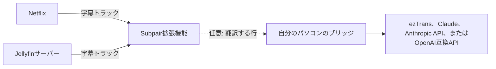

# Subpairのセットアップ

Subpairは、**Netflix**と**Jellyfin**で字幕を2行同時に表示します。1行は学習中の言語、もう1行は自分の言語です。作品に自分の言語のトラックがない場合は、パソコン上で動く任意のプログラムである**ブリッジ**が、メイン字幕を翻訳します。



作品に両方の言語の字幕がすでにある場合は、ステップ1〜3だけで十分です。ステップ4〜7で翻訳を追加します。

## 1. 拡張機能のインストール

**Chrome、Edge、BraveなどのChromium系ブラウザー**（バージョン111以降）：

1. このリポジトリをダウンロード（Code、Download ZIP）して展開するか、`git clone`します。
2. `chrome://extensions`（Edgeでは`edge://extensions`）を開き、**デベロッパー モード**をオンにします。
3. **パッケージ化されていない拡張機能を読み込む**をクリックし、`manifest.json`があるフォルダーを選びます。
4. Subpairのアイコンをツールバーに固定します。このアイコンがオン/オフのスイッチになります。

**Firefox 128以降**では、ビルド手順と[Node.js](https://nodejs.org/) 21以降が必要です。

1. リポジトリのフォルダーで`npm run build:firefox`を実行します。これで`dist/firefox`が作られます。
2. `about:debugging#/runtime/this-firefox`を開き、**一時的なアドオンを読み込む**をクリックして、`dist/firefox/manifest.json`を選びます。

Firefoxは再起動時に一時的なアドオンを削除するため、再起動後はもう一度読み込んでください。常時インストールするにはMozillaが署名したバージョンが必要ですが、まだ公開されていません。

## 2. 言語を選ぶ

初めてインストールすると、ウェルカムメッセージとともにSubpairの設定が開きます。**言語**で次を選びます。

- **メイン字幕**：一緒に読む字幕です。通常は学習中の言語です。
- **2行目の字幕**：自分の言語です。ブラウザーの言語に合わせてあらかじめ選ばれています。

各行には第一候補と、最大2つの予備の言語を指定できます。動画に字幕トラックがある最初の言語が使われます。上部の**設定を保存**を押してください。メイン字幕の言語を選ぶまでは何も表示されません。


## 3. 動画を見る

**Netflix**：netflix.comを開いて作品を再生します。Subpairをインストールまたは更新した後は、**Netflixのタブを一度再読み込み**してください。SubpairはNetflixのプレーヤーが読み込まれる間に字幕の一覧を読み取るためです。Subpairがオンの間、Netflix自体の字幕は非表示になります。

**Jellyfin**（Jellyfin 12.2でテスト済み）：ブラウザーでサーバーのWebクライアントを開き、テキスト字幕のあるアイテムを再生します。初回は右上に「**このサーバーでSubpairを使いますか?**」という通知が表示されます。クリックするとこのサーバーを許可します。許可したサーバーは設定の**Jellyfinサーバー**に一覧表示され、そこから削除することもできます。

Subpairがオフの間（ツールバーボタン、または**Alt+Shift+S**）は、各サイト自体の字幕が表示されます。右上の小さな通知から再びオンにできます。

| 操作 | キーまたはマウス |
|---|---|
| 前の行 / この行をリピート / 次の行 | `A` / `R` / `D`（設定で変更できます） |
| 各行の終わりで自動一時停止 | `Q`、またはAPボタン |
| 単語 / 辞書形 / 行全体をコピー | クリック / Ctrl+クリック / Alt+クリック |
| Subpairのオン/オフ | ツールバーボタン、またはAlt+Shift+S |


**歯車**ボタンを押すと、視聴中の動画のクイック設定が開きます。メイン字幕と2行目の字幕、翻訳エンジン、字幕のタイミング、文字サイズ、位置、背景、自動一時停止、トランスクリプトパネルを設定できます。


トランスクリプトパネルには、すべての行が時間とともに一覧表示されます。行をクリックするとその位置に移動します。日本語の単語は品詞ごとに色分けされます。単語をクリックするとその単語を、Ctrl+クリックすると辞書形をコピーします。


## 4. 任意：ブリッジのインストール

ブリッジは、パソコン上で動き、拡張機能から頼まれた翻訳を行う小さなNode.jsプログラムです。`127.0.0.1`でのみ待ち受けるため、ほかの端末からは接続できません。

1. [Node.js](https://nodejs.org/) 21以降をインストールします。
2. リポジトリのフォルダーで`npm install`を実行します。
3. `bridge/config.example.json`を`bridge/config.json`にコピーします。変更が必要な項目だけを書き換えてください。省略した設定はすべて`bridge/config.defaults.json`の値になります。
4. `npm run bridge`で起動します。`bridge on http://127.0.0.1:8765`と、翻訳を保存するフォルダーが表示されます。

保存された翻訳はユーザーデータフォルダーにあります。Windowsは`%LOCALAPPDATA%\subpair`、macOSは`~/Library/Application Support/subpair`、Linuxは`$XDG_DATA_HOME/subpair`または`~/.local/share/subpair`です。

## 5. 任意：翻訳エンジンを選ぶ

Subpairの設定の**翻訳**で、翻訳エンジンと翻訳のタイミングを選びます。ポートを変更していなければ、**ブリッジのアドレス**は`http://127.0.0.1:8765`のままにしておきます。

| 翻訳エンジン | 言語 | 必要なもの |
|---|---|---|
| 自動（既定） | すべて | この表の順で、その言語ペアに対応できる最初のもの |
| ezTrans | 日本語から韓国語のみ | Windows、ezTrans XPのインストール、LunaTranslatorのヘルパー（[翻訳](translation.html#eztrans)を参照） |
| Claude (`claude -p`) | すべて | [Claude Code](https://claude.com/claude-code)のインストールとログイン。APIキーではなくClaudeのプランを使います |
| Anthropic API | すべて | `ANTHROPIC_API_KEY`、または`bridge/config.json`の`api.key`に設定したAPIキー |
| OpenAI互換 | すべて | `bridge/config.json`の`openai.baseUrl`と`openai.model`。ホスティングサービス（OpenAI、Gemini、DeepSeekなど）ではキーも必要です。Ollamaなどのローカルサーバーはキー不要です |

**翻訳のタイミング**：「自動」は、ezTransでは動画の数行先までを翻訳し、その他の翻訳エンジンでは作品全体を先に翻訳します。「リアルタイム」は常に数行先までを翻訳します。「作品全体を先に翻訳してから表示」は、すべてを翻訳してから表示します。完了した翻訳は保存され、次回はすぐに読み込まれます。

翻訳エンジンごとに**モデル**欄があります。空欄にするとブリッジの既定値が使われ、ブリッジの起動中はその値が欄にグレーで表示されます。費用とキーについては[翻訳](translation.html)を参照してください。

## 6. 任意：ブリッジの利用をSubpairだけに許可する

既定では、パソコン上のどのブラウザー拡張機能でもブリッジを呼び出せます。ブリッジも起動時にそのことを表示します。Subpairだけに許可するには、SubpairのID（Chromeは`chrome://extensions`に表示されるID、Firefoxは`about:debugging#/runtime/this-firefox`の「内部 UUID」）を調べて`bridge/config.json`に追加し、ブリッジを再起動します。

```json
{ "allowedOrigins": ["chrome-extension://<the ID>"] }
```

Firefoxの場合、オリジンは`moz-extension://<the Internal UUID>`です。

## 7. 任意：ブリッジをパソコンと一緒に起動する

Windows、macOS、Linuxでの方法は、[起動時にブリッジを実行する](translation.html#起動時にブリッジを実行する)を参照してください。

## 動作の確認

- ブリッジの起動中に`http://127.0.0.1:8765/health`を開きます。`backends`には各翻訳エンジンが使えるかどうかが、`models`には各翻訳エンジンの既定のモデルが表示されます。
- プレーヤーでは、歯車メニューの**翻訳エンジン**の行に使用中の翻訳エンジンが表示され、作品全体の翻訳中はその進み具合も表示されます（例：「Claude、作品全体 120/840」）。
- うまくいかない場合は、[トラブルシューティング](troubleshooting.html)を参照してください。
