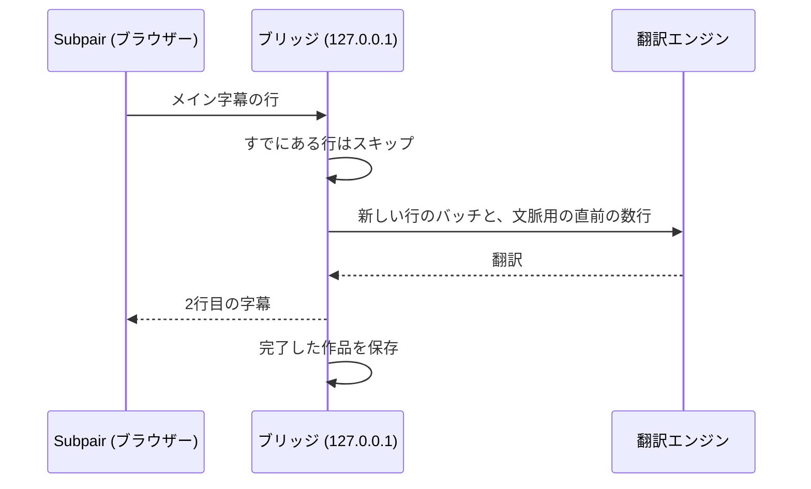

# ブリッジによる翻訳

作品に2行目の字幕の言語のトラックがない場合、Subpairはパソコン上で動く小さなNode.jsプログラムである**ブリッジ**を通じて、メイン字幕を翻訳できます（[ブリッジのインストール](https://github.com/wonjoonSeol-WS/subpair/blob/main/README.ja.md#翻訳任意)を参照）。ブリッジは翻訳したすべての行と完了したすべての作品を保存するため、同じ翻訳に二度料金を払うことはなく、一度見た作品はすぐに読み込まれます。



## 設定ファイル

ブリッジは、優先度の低いものから順に次の設定を読み込みます。

1. `bridge/config.defaults.json`：すべての設定とその既定値です（コードの一部なので編集しないでください）。
2. `bridge/config.json`：自分で変更した設定です。`bridge/config.example.json`をもとに作成してください。APIキーを含むことがあるため、gitの管理対象から除外されています。
3. 環境変数：`BRIDGE_PORT`、`BRIDGE_STORE`、`ANTHROPIC_API_KEY`、`OPENAI_API_KEY`。

既定値ファイルにない設定名はエラーになるため、タイプミスのせいで設定が黙って無視されることはありません。設定や環境変数を変更したら、ブリッジを再起動してください。

## 翻訳エンジン

| 翻訳エンジン | キー | 設定方法 |
|---|---|---|
| ezTrans | なし | Windowsのみ、日本語から韓国語。[ezTrans](#eztrans)を参照してください。 |
| Claude (`claude -p`) | なし | [Claude Code](https://claude.com/claude-code)をインストールし、ブリッジを実行するのと同じユーザーで`claude`を一度実行してログインします。翻訳はClaudeのプランの使用量に含まれます。 |
| Anthropic API | `ANTHROPIC_API_KEY`または`api.key` | 既定のモデルは`claude-haiku-5-5`です。 |
| OpenAI互換 | `OPENAI_API_KEY`または`openai.key` | `openai.baseUrl`と`openai.model`を設定します。自分のパソコンやローカルネットワーク上のサーバーは、通常キーが不要です。 |

`claude`コマンドはシェルを介さずに起動されます。Windowsでは、Claude Codeをネイティブインストーラー（PATH上の`.exe`）でインストールするか、`claude.command`に`claude.exe`のフルパスを設定してください。

GeminiのOpenAI互換エンドポイントを使う`bridge/config.json`の例：

```json
{
  "openai": {
    "baseUrl": "https://generativelanguage.googleapis.com/v1beta/openai",
    "model": "<a Gemini model name>"
  }
}
```

ローカルの[Ollama](https://ollama.com/)の場合：

```json
{ "openai": { "baseUrl": "http://127.0.0.1:11434/v1", "model": "<the model you pulled>" } }
```

キーは、ブリッジを起動するターミナルまたはサービスに設定します。

| システム | このセッションのみ | 永続的に |
|---|---|---|
| Windows PowerShell | `$env:OPENAI_API_KEY = "<key>"; npm run bridge` | `setx OPENAI_API_KEY "<key>"`を実行し、新しいターミナルを開く |
| macOS、Linux（bash、zsh） | `OPENAI_API_KEY="<key>" npm run bridge` | `~/.zshrc`または`~/.bashrc`に`export OPENAI_API_KEY="<key>"`を追加 |

launchd（macOS）やsystemd（Linux）で起動するサービスは、シェルのプロファイルを読み込みません。キーは`bridge/config.json`かサービス定義に記述してください。

## モデル

Subpairの設定には、翻訳エンジンごとに**モデル**欄があります。空欄の場合はブリッジの既定値が使われ、ブリッジの起動中はその値がグレーで表示されます。このブリッジを使うすべての人の既定値を変えるには、`bridge/config.json`で設定します。例：

```json
{ "claude": { "model": "sonnet" } }
```

モデル名には英字、数字、`. : / - _`を使えます。翻訳はモデルごとに別々に保存されるため、モデルを切り替えても翻訳が混ざることはありません。

## 行の送り方

行の送り方は翻訳エンジンによって異なります。

- **ezTrans**は、動画の数行先までを1行ずつ翻訳します。
- **言語モデル**には、最大40行を番号付きリストにしたバッチと、そのバッチの直前の6行を文脈として送ります。作品全体は複数のバッチに分割され、翻訳済みの行（または繰り返しの行）はスキップされ、同時に2つのバッチ（Anthropic APIでは3つ）が処理されます。結果がおかしかったバッチは半分に分けて再試行し、それでも失敗した1行は、作品全体を失敗させるのではなくその行だけ除外されます。

翻訳エンジンごとに、`bridge/config.json`で`batch`、`context`、`concurrency`、`timeoutMs`を変更できます。

## 費用

Anthropic APIとClaude Haiku 5.5（`claude-haiku-5-5`、既定値。執筆時点で入力100万トークンあたり$0.10、出力100万トークンあたり$0.50。[Anthropicの料金](https://www.anthropic.com/pricing)を参照）で、約300行のアニメ1話を翻訳した場合のおおよその費用です。

| | 1話あたり | 12話の1シーズン |
|---|---|---|
| リクエスト | 約8回（40行ずつのバッチ） | 約96回 |
| 入力 | 1リクエストあたり約1,500トークン | |
| 出力 | 1リクエストあたり約1,200〜2,000トークン | |
| **費用** | **約$0.006〜$0.01** | **約$0.07〜$0.12**（再試行込みでも$0.30未満） |

これらは実測値ではなく推定値です。日本語や韓国語の1文字を約1トークン、リクエストごとに250トークンの指示と6行の文脈、`api.effort`を`low`に設定した場合を前提にしています。翻訳済みの行に再び料金がかかることはありません。Claude翻訳エンジン（`claude -p`）はトークン単位の課金ではなくClaudeのプランを使い、ezTransとローカルモデルは行ごとの費用がかかりません。

## 保存された翻訳

完了した作品は、ブリッジのデータフォルダーに保存されます。Windowsは`%LOCALAPPDATA%\subpair`、macOSは`~/Library/Application Support/subpair`、Linuxは`$XDG_DATA_HOME/subpair`または`~/.local/share/subpair`です（`storeDir`または`BRIDGE_STORE`で変更できます）。

プレーヤーの歯車メニューでは次の操作ができます。

- **翻訳エンジン**、**翻訳のタイミング**：自動、リアルタイム (数行先まで)、今すぐ作品全体から選びます。
- **翻訳エンジン**、**この作品をもう一度翻訳**：新しく翻訳し、保存済みの翻訳を置き換えます（2回クリック）。
- **2行目の字幕**、**代わりにメイン字幕を翻訳**：作品に含まれるその言語のトラックを無視します。トラックの内容がおかしい、またはタイミングがずれているときに使います。作品ごとに記憶されます。

ほかのJellyfinアプリ（テレビ、スマートフォン）では、保存された翻訳は表示されません。

## 起動時にブリッジを実行する

常に動かしておくブリッジには、8777など別のポートを使ってください。そうすれば開発中も`npm run bridge`（8765）をそのまま使えます。拡張機能の**ブリッジのアドレス**も同じポートに設定します。

### Windows

`scripts\windows\run-bridge.ps1`はブリッジを非表示で実行し、停止すると再起動します（5秒待ってから、待ち時間を倍にしながら最大60秒まで延ばし、短時間での失敗が8回続くとあきらめます）。また、ポートごとに1つしか実行されないようにし、そのポートで動いたままのブリッジを停止して、出力をログ（既定は`%LOCALAPPDATA%\subpair\bridge.log`）に追記します。ログオン時に起動し、5分ごとに確認するタスクとしてタスクスケジューラに登録してください（PowerShellで、リポジトリのフォルダーから実行）。

```powershell
$script   = (Resolve-Path 'scripts\windows\run-bridge.ps1').Path
$action   = New-ScheduledTaskAction -Execute 'powershell.exe' -Argument "-WindowStyle Hidden -NoProfile -ExecutionPolicy Bypass -File `"$script`" -Port 8777"
$triggers = @(
  New-ScheduledTaskTrigger -AtLogOn -User "$env:USERDOMAIN\$env:USERNAME"
  New-ScheduledTaskTrigger -Once -At (Get-Date).Date -RepetitionInterval (New-TimeSpan -Minutes 5)
)
$settings = New-ScheduledTaskSettingsSet -ExecutionTimeLimit (New-TimeSpan -Seconds 0) -MultipleInstances IgnoreNew -AllowStartIfOnBatteries -DontStopIfGoingOnBatteries
Register-ScheduledTask -TaskName 'Subpair bridge' -Action $action -Trigger $triggers -Settings $settings
Start-ScheduledTask -TaskName 'Subpair bridge'
```

`Invoke-RestMethod http://127.0.0.1:8777/health`で確認できます。スクリプトのオプションは`-Port`、`-Log`、`-Repo`、`-Node`、`-MaxQuickFailures`です。完全に止めるには、`Unregister-ScheduledTask -TaskName 'Subpair bridge'`を実行してから、`bridge\server.mjs`を実行している`node`プロセスを終了します。

### macOS（未検証）

次の内容を、パスを自分の環境に合わせて`~/Library/LaunchAgents/com.subpair.bridge.plist`として保存します（Nodeのパスは`which node`で確認できます）。

```xml
<?xml version="1.0" encoding="UTF-8"?>
<!DOCTYPE plist PUBLIC "-//Apple//DTD PLIST 1.0//EN" "http://www.apple.com/DTDs/PropertyList-1.0.dtd">
<plist version="1.0">
<dict>
  <key>Label</key><string>com.subpair.bridge</string>
  <key>ProgramArguments</key>
  <array><string>/opt/homebrew/bin/node</string><string>/path/to/subpair/bridge/server.mjs</string></array>
  <key>EnvironmentVariables</key><dict><key>BRIDGE_PORT</key><string>8777</string></dict>
  <key>RunAtLoad</key><true/>
  <key>KeepAlive</key><true/>
  <key>StandardOutPath</key><string>/tmp/subpair-bridge.log</string>
  <key>StandardErrorPath</key><string>/tmp/subpair-bridge.log</string>
</dict>
</plist>
```

その後、`launchctl bootstrap gui/$(id -u) ~/Library/LaunchAgents/com.subpair.bridge.plist`を実行します。

### Linux（未検証）

次の内容を`~/.config/systemd/user/subpair-bridge.service`として保存します。

```ini
[Unit]
Description=Subpair translation bridge

[Service]
Environment=BRIDGE_PORT=8777
ExecStart=/usr/bin/node /path/to/subpair/bridge/server.mjs
Restart=on-failure

[Install]
WantedBy=default.target
```

その後、`systemctl --user enable --now subpair-bridge`を実行します。

## Subpairだけを許可する

初期設定では、このパソコンのどのブラウザー拡張機能もブリッジを呼び出せます。ブリッジは起動時にそのことを表示します。Subpairだけを許可するには、`bridge/config.json`にSubpairのオリジンを追加して、ブリッジを再起動してください。

```json
{ "allowedOrigins": ["chrome-extension://<the ID shown on chrome://extensions>"] }
```

Firefoxでは`moz-extension://<about:debugging#/runtime/this-firefoxに表示される内部UUID>`を使います。拡張機能を別のフォルダーから読み込むとIDが変わり、IDを更新するまで、ブリッジは「許可されていないオリジン」と応答します。

## ezTrans

ezTrans XPは、日本語を韓国語に翻訳するWindows用のソフトウェアです。Subpairには含まれていないため、ご自身でインストールしてください。ブリッジはLunaTranslatorの32ビット版ヘルパーを介してezTransとやり取りします。このヘルパーはSubpairに同梱されており、`bridge/vendor/lunatranslator`にあります（GPL-3.0、LunaTranslatorの公式リリースから取得。ソースとバージョンはそのフォルダーのREADMEに記載）。`bridge/config.json`に必要なのはezTrans XPのフォルダーだけです。

```json
{ "eztrans": { "dir": "C:/Program Files (x86)/ChangShinSoft/ezTrans XP" } }
```

同梱のヘルパーではなく自分で用意したヘルパーを使うには、`eztrans.helper`にそのフルパスを設定してください（別の作業フォルダーが必要な場合は`eztrans.cwd`も設定します）。macOSとLinuxではezTransを設定せず、ほかの翻訳エンジンを使ってください。
