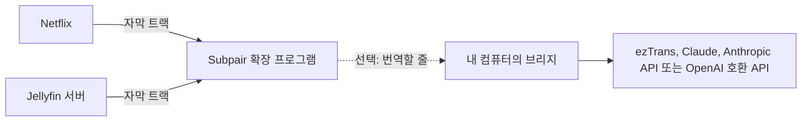
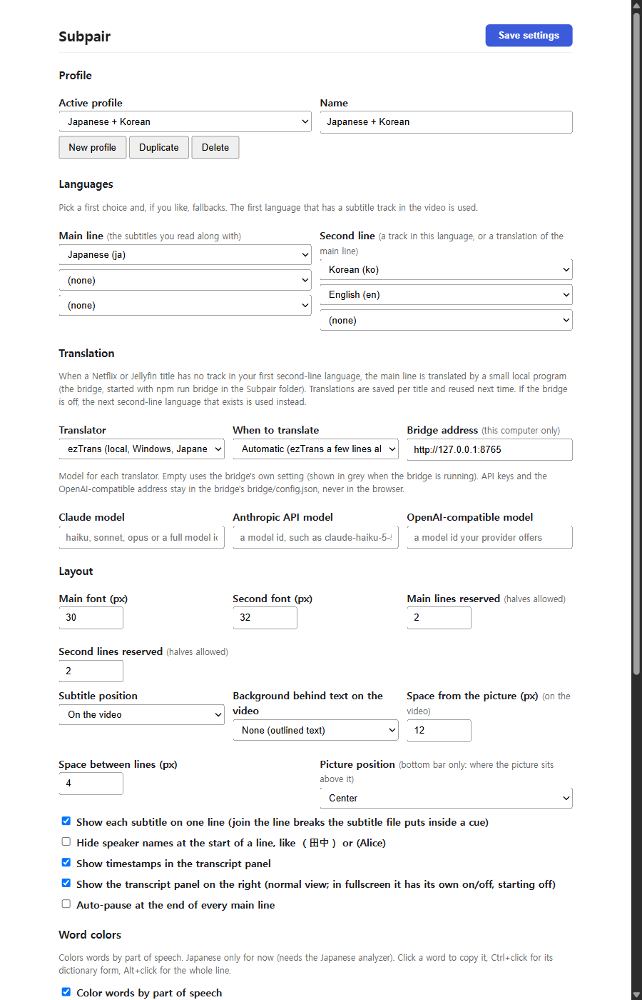
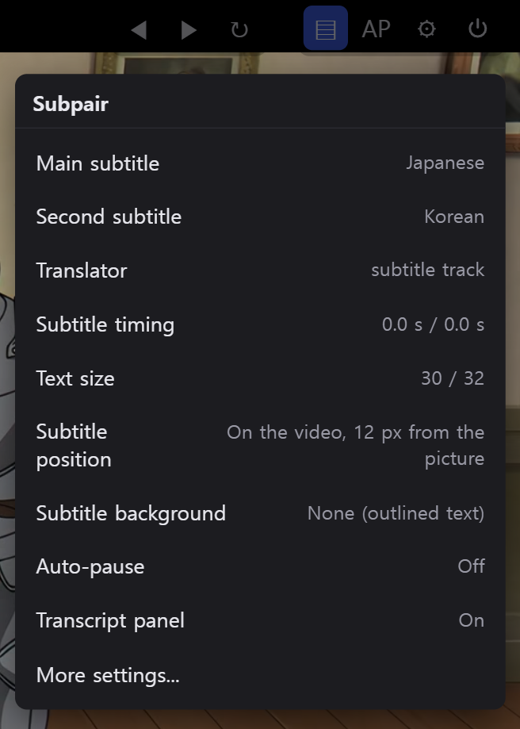
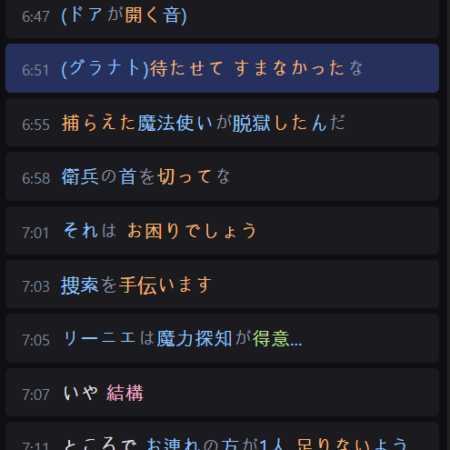

# Subpair 설치하기

Subpair는 **Netflix**와 **Jellyfin**에서 자막 두 줄을 함께 보여 줍니다. 한 줄은 배우고 있는 언어, 다른 한 줄은 내
언어입니다. 작품에 내 언어 트랙이 없으면 컴퓨터에서 실행하는 프로그램인 **브리지**(선택 사항)가 주 자막을 번역해
줍니다.



작품에 이미 두 언어의 자막이 모두 있다면 1단계부터 3단계까지만 하면 됩니다. 4단계부터 7단계까지는 번역 기능을
추가하는 과정입니다.

## 1. 확장 프로그램 설치

**Chrome, Edge, Brave 등 Chromium 브라우저**(버전 111 이상):

1. 이 저장소를 내려받아(Code, Download ZIP) 압축을 풀거나 `git clone`으로 받습니다.
2. `chrome://extensions`(Edge는 `edge://extensions`)를 열고 **개발자 모드**를 켭니다.
3. **압축해제된 확장 프로그램을 로드합니다**를 클릭하고 `manifest.json`이 들어 있는 폴더를 선택합니다.
4. 툴바에 Subpair 아이콘을 고정합니다. 이 아이콘이 켜기/끄기 스위치입니다.

**Firefox 128 이상**은 빌드 단계와 [Node.js](https://nodejs.org/) 21 이상이 필요합니다.

1. 저장소 폴더에서 `npm run build:firefox`를 실행합니다. 그러면 `dist/firefox`가 만들어집니다.
2. `about:debugging#/runtime/this-firefox`를 열고 **임시 부가 기능 로드**를 클릭한 다음
   `dist/firefox/manifest.json`을 선택합니다.

Firefox는 다시 시작할 때 임시 부가 기능을 제거하므로, 재시작한 뒤에는 다시 불러와야 합니다. 영구 설치에는 Mozilla가
서명한 버전이 필요한데, 아직 공개되지 않았습니다.

## 2. 언어 선택

처음 설치하면 환영 메시지와 함께 Subpair 설정이 열립니다. **언어** 항목에서 다음을 고릅니다.

- **주 자막**: 함께 읽을 자막으로, 보통 배우고 있는 언어입니다.
- **두 번째 자막**: 내 언어입니다. 브라우저 언어에 맞춰 미리 선택되어 있습니다.

줄마다 첫 번째 선택과 최대 두 개의 대체 언어를 지정할 수 있습니다. 영상에 자막 트랙이 있는 첫 번째 언어가
사용됩니다. 위쪽의 **설정 저장**을 누르세요. 주 자막 언어를 고르기 전에는 아무것도 표시되지 않습니다.



## 3. 영상 보기

**Netflix**: netflix.com을 열고 작품을 재생합니다. Subpair를 설치하거나 업데이트한 뒤에는 **Netflix 탭을 한 번
새로고침**하세요. Subpair는 Netflix 플레이어가 로드되는 동안 자막 목록을 읽습니다. Subpair가 켜져 있는 동안에는
Netflix 자체 자막이 숨겨집니다.

**Jellyfin**(Jellyfin 12.2에서 테스트): 브라우저에서 서버의 웹 클라이언트를 열고 텍스트 자막이 있는 항목을
재생합니다. 처음에는 오른쪽 위에 **이 서버에서 Subpair를 사용할까요?** 알림이 나타납니다. 알림을 클릭하면 이 서버를
허용합니다. 허용한 서버는 설정의 **Jellyfin 서버**에 나열되며, 여기서 다시 삭제할 수 있습니다.

Subpair가 꺼져 있는 동안(툴바 버튼 또는 **Alt+Shift+S**)에는 각 사이트의 자체 자막이 표시됩니다. 오른쪽 위의 작은
알림을 누르면 다시 켜집니다.

| 동작 | 키 또는 마우스 |
|---|---|
| 이전 줄 / 현재 줄 반복 / 다음 줄 | `A` / `R` / `D` (설정에서 변경 가능) |
| 줄이 끝날 때마다 자동 일시정지 | `Q` 또는 AP 버튼 |
| 단어 / 기본형 / 줄 전체 복사 | 클릭 / Ctrl+클릭 / Alt+클릭 |
| Subpair 켜기/끄기 | 툴바 버튼 또는 Alt+Shift+S |


**톱니바퀴** 버튼을 누르면 보고 있는 영상의 빠른 설정이 열립니다. 주 자막과 두 번째 자막, 번역기, 자막 싱크, 글자
크기, 위치, 배경, 자동 일시정지, 대본 패널을 바꿀 수 있습니다.



대본 패널에는 모든 줄이 시간과 함께 나열되며, 줄을 클릭하면 그 위치로 이동합니다. 일본어 단어는 품사별로 색이
입혀집니다. 단어를 클릭하면 그 단어를, Ctrl+클릭하면 기본형을 복사합니다.



## 4. 선택: 브리지 설치

브리지는 컴퓨터에서 실행되며 확장 프로그램이 요청한 번역을 처리하는 작은 Node.js 프로그램입니다. `127.0.0.1`에서만
연결을 받으므로 다른 기기에서는 접속할 수 없습니다.

1. [Node.js](https://nodejs.org/) 21 이상을 설치합니다.
2. 저장소 폴더에서 `npm install`을 실행합니다.
3. `bridge/config.example.json`을 `bridge/config.json`으로 복사합니다. 필요한 부분만 바꾸세요. 생략한 설정은 모두
   `bridge/config.defaults.json`의 값을 씁니다.
4. `npm run bridge`로 실행합니다. `bridge on http://127.0.0.1:8765`와 번역을 저장할 폴더가 출력됩니다.

저장된 번역은 사용자 데이터 폴더에 있습니다. Windows는 `%LOCALAPPDATA%\subpair`,
macOS는 `~/Library/Application Support/subpair`, Linux는 `$XDG_DATA_HOME/subpair` 또는 `~/.local/share/subpair`입니다.

## 5. 선택: 번역기 고르기

Subpair 설정의 **번역** 항목에서 번역기와 번역 시점을 고릅니다. 포트를 바꾸지 않았다면 **브리지 주소**는
`http://127.0.0.1:8765` 그대로 둡니다.

| 번역기 | 언어 | 필요한 것 |
|---|---|---|
| 자동(기본값) | 모든 언어 | 이 표의 순서대로, 해당 언어쌍에 준비된 첫 번째 번역기 |
| ezTrans | 일본어에서 한국어만 | Windows, ezTrans XP 설치, LunaTranslator의 헬퍼([번역](translation.html#eztrans) 참고) |
| Claude (`claude -p`) | 모든 언어 | [Claude Code](https://claude.com/claude-code) 설치와 로그인. API 키가 아니라 Claude 요금제를 사용합니다 |
| Anthropic API | 모든 언어 | `ANTHROPIC_API_KEY` 또는 `bridge/config.json`의 `api.key`에 넣은 API 키 |
| OpenAI 호환 | 모든 언어 | `bridge/config.json`의 `openai.baseUrl`과 `openai.model`, 호스팅 서비스(OpenAI, Gemini, DeepSeek 등)라면 키도 필요. Ollama 같은 로컬 서버는 키가 필요 없습니다 |

**번역 시점**: *자동*은 ezTrans일 때는 영상보다 몇 줄 앞서 번역하고, 다른 번역기일 때는 작품 전체를 먼저
번역합니다. *실시간*은 항상 몇 줄 앞서 번역합니다. *작품 전체를 먼저 번역한 뒤 표시*는 모두 번역한 다음 보여
줍니다. 끝난 번역은 저장되어 다음에는 바로 불러옵니다.

번역기마다 **모델** 칸이 있습니다. 비워 두면 브리지의 기본값을 쓰며, 브리지가 실행 중일 때는 그 기본값이 칸에
회색으로 표시됩니다. 비용과 키는 [번역](translation.html)에서 설명합니다.

## 6. 선택: Subpair만 브리지를 쓰도록 허용

기본적으로는 컴퓨터의 모든 브라우저 확장 프로그램이 브리지를 호출할 수 있으며, 브리지도 시작할 때 이 사실을 알려
줍니다. Subpair만 허용하려면 Subpair의 ID(Chrome: `chrome://extensions`에 표시되는 ID, Firefox:
`about:debugging#/runtime/this-firefox`의 *내부 UUID*)를 찾아 `bridge/config.json`에 추가한 다음 브리지를 다시
시작합니다.

```json
{ "allowedOrigins": ["chrome-extension://<the ID>"] }
```

Firefox에서는 출처가 `moz-extension://<the Internal UUID>`입니다.

## 7. 선택: 컴퓨터를 켤 때 브리지 시작

Windows, macOS, Linux에서 설정하는 방법은 [시작 시 브리지 실행](translation.html#시작-시-브리지-실행)을 참고하세요.

## 동작 확인

- 브리지가 실행 중일 때 `http://127.0.0.1:8765/health`를 엽니다. `backends`에는 번역기별 사용 가능 여부가,
  `models`에는 번역기별 기본 모델이 표시됩니다.
- 플레이어에서는 톱니바퀴 메뉴의 **번역기** 항목에 현재 번역기가 표시되며, 작품 전체를 번역하는 중에는 진행률도
  함께 표시됩니다(예: *Claude, 작품 전체 120/840*).
- 문제가 있으면 [문제 해결](troubleshooting.html)을 참고하세요.
