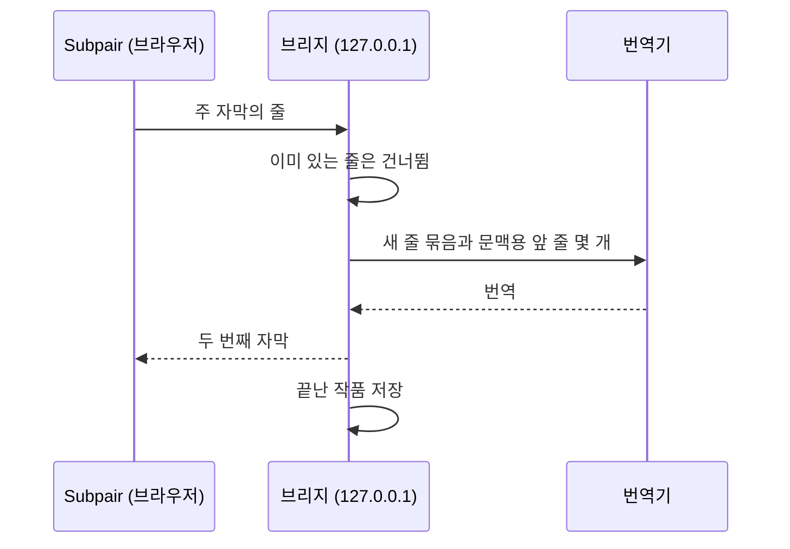

# 브리지로 번역하기

작품에 두 번째 자막 언어의 트랙이 없으면, Subpair는 컴퓨터에서 실행하는 작은 Node.js 프로그램인 **브리지**를 통해
주 자막을 번역할 수 있습니다([설치](./#4-선택-브리지-설치) 참고). 브리지는 번역한 줄과 끝난 작품을 모두 보관하므로
같은 번역에 비용을 두 번 내지 않으며, 이미 본 작품은 바로 불러옵니다.



## 설정 파일

브리지는 우선순위가 낮은 것부터 다음 순서로 설정을 읽습니다.

1. `bridge/config.defaults.json`: 모든 설정과 기본값입니다(코드의 일부이므로 수정하지 마세요).
2. `bridge/config.json`: 직접 바꾼 설정입니다. `bridge/config.example.json`에서 시작하세요. API 키가 들어갈 수
   있으므로 git에서 무시됩니다.
3. 환경 변수: `BRIDGE_PORT`, `BRIDGE_STORE`, `ANTHROPIC_API_KEY`, `OPENAI_API_KEY`.

기본값 파일에 없는 설정 이름은 오류로 처리되므로, 오타가 있어도 조용히 무시되는 일이 없습니다. 설정이나 환경 변수를
바꾼 뒤에는 브리지를 다시 시작하세요.

## 번역기

| 번역기 | 키 | 설정 방법 |
|---|---|---|
| ezTrans | 없음 | Windows 전용, 일본어에서 한국어로. [ezTrans](#eztrans)를 참고하세요. |
| Claude (`claude -p`) | 없음 | [Claude Code](https://claude.com/claude-code)를 설치하고, 브리지를 실행하는 사용자와 같은 사용자로 `claude`를 한 번 실행해 로그인합니다. 번역은 Claude 요금제 사용량에 포함됩니다. |
| Anthropic API | `ANTHROPIC_API_KEY` 또는 `api.key` | 기본 모델은 `claude-haiku-5-5`입니다. |
| OpenAI 호환 | `OPENAI_API_KEY` 또는 `openai.key` | `openai.baseUrl`과 `openai.model`을 설정합니다. 내 컴퓨터나 로컬 네트워크의 서버는 보통 키가 필요 없습니다. |

`claude` 명령은 셸 없이 실행됩니다. Windows에서는 Claude Code를 네이티브 설치 프로그램으로 설치하거나(PATH에 있는
`.exe`), `claude.command`를 `claude.exe`의 전체 경로로 설정하세요.

Gemini의 OpenAI 호환 엔드포인트를 쓰는 `bridge/config.json` 예시:

```json
{
  "openai": {
    "baseUrl": "https://generativelanguage.googleapis.com/v1beta/openai",
    "model": "<a Gemini model name>"
  }
}
```

로컬 [Ollama](https://ollama.com/)의 경우:

```json
{ "openai": { "baseUrl": "http://127.0.0.1:11434/v1", "model": "<the model you pulled>" } }
```

키는 브리지를 시작하는 터미널이나 서비스에 설정합니다.

| 시스템 | 이번 세션만 | 영구 |
|---|---|---|
| Windows PowerShell | `$env:OPENAI_API_KEY = "<key>"; npm run bridge` | `setx OPENAI_API_KEY "<key>"` 실행 후 새 터미널 열기 |
| macOS, Linux (bash, zsh) | `OPENAI_API_KEY="<key>" npm run bridge` | `~/.zshrc` 또는 `~/.bashrc`에 `export OPENAI_API_KEY="<key>"` 추가 |

launchd(macOS)나 systemd(Linux)가 시작하는 서비스는 셸 프로필을 읽지 않습니다. 키를 `bridge/config.json`이나 서비스
정의에 넣으세요.

## 모델

Subpair 설정에는 번역기마다 **모델** 칸이 있습니다. 비워 두면 브리지의 기본값을 쓰며, 브리지가 실행 중일 때는 그
값이 회색으로 표시됩니다. 이 브리지를 쓰는 모든 사용자의 기본값을 바꾸려면 `bridge/config.json`에 설정합니다. 예:

```json
{ "claude": { "model": "sonnet" } }
```

모델 이름에는 영문자, 숫자, `. : / - _`를 쓸 수 있습니다. 모델마다 번역이 따로 저장되므로 모델을 바꿔도 번역이
섞이지 않습니다.

## 줄을 보내는 방식

줄을 보내는 방식은 번역기에 따라 다릅니다.

- **ezTrans**는 영상보다 몇 줄 앞서 한 줄씩 번역합니다.
- **언어 모델**에는 최대 40줄을 번호를 매긴 목록으로 묶어 보내고, 묶음 앞의 6줄을 문맥으로 함께 보냅니다. 작품
  전체는 여러 묶음으로 나누며, 이미 번역한 줄(또는 반복되는 줄)은 건너뛰고, 한 번에 2개 묶음(Anthropic API는
  3개)을 실행합니다. 잘못된 결과가 돌아온 묶음은 반으로 나누어 다시 시도하며, 그래도 실패한 한 줄은 작품 전체를
  실패로 만드는 대신 그 줄만 빠집니다.

번역기별로 `bridge/config.json`에서 `batch`, `context`, `concurrency`, `timeoutMs`를 바꿀 수 있습니다.

## 비용

Anthropic API와 Claude Haiku 5.5(`claude-haiku-5-5`, 기본값. 작성 시점 기준 입력 토큰 100만 개당 $0.10, 출력 토큰
100만 개당 $0.50, [Anthropic 요금](https://www.anthropic.com/pricing) 참고)로 약 300줄짜리 애니메이션 한 화를
번역할 때의 대략적인 비용입니다.

| | 한 화 | 12화 시즌 |
|---|---|---|
| 요청 | 약 8회(40줄 묶음) | 약 96회 |
| 입력 | 요청당 약 1,500토큰 | |
| 출력 | 요청당 약 1,200~2,000토큰 | |
| **비용** | **약 $0.006~$0.01** | **약 $0.07~$0.12**(재시도 포함 시 $0.30 미만) |

이 값은 측정값이 아닌 추정치입니다. 일본어나 한국어 한 글자당 약 1토큰, 요청마다 250토큰 분량의 지시문과 문맥 6줄,
`api.effort`를 `low`로 설정한 경우를 가정했습니다. 이미 번역한 줄에는 다시 비용이 들지 않습니다. Claude
번역기(`claude -p`)는 토큰당 과금 대신 Claude 요금제를 사용하며, ezTrans와 로컬 모델은 줄마다 드는 비용이 없습니다.

## 저장된 번역

끝난 작품은 브리지의 데이터 폴더에 저장됩니다. Windows는 `%LOCALAPPDATA%\subpair`,
macOS는 `~/Library/Application Support/subpair`,
Linux는 `$XDG_DATA_HOME/subpair` 또는 `~/.local/share/subpair`입니다(`storeDir` 또는 `BRIDGE_STORE`로 바꿀 수 있습니다).

플레이어의 톱니바퀴 메뉴에서는 다음을 할 수 있습니다.

- **번역기**, **번역 시점**: 자동, 실시간 (몇 줄 앞서), 지금 작품 전체 중에서 고릅니다.
- **번역기**, **이 작품 다시 번역**: 새로 번역해 저장된 번역을 바꿉니다(두 번 클릭).
- **두 번째 자막**, **대신 주 자막을 번역**: 작품에 들어 있는 그 언어의 트랙을 무시합니다. 트랙이 이상하거나 싱크가
  맞지 않을 때 씁니다. 작품마다 기억합니다.

다른 Jellyfin 앱(TV, 휴대폰)에서는 저장된 번역이 보이지 않습니다.

## 시작 시 브리지 실행

항상 실행해 둘 브리지는 8777처럼 다른 포트를 쓰세요. 그러면 개발하는 동안에도 `npm run bridge`(8765)를 그대로 쓸 수
있습니다. 확장 프로그램의 **브리지 주소**도 같은 포트로 설정합니다.

### Windows

`scripts\windows\run-bridge.ps1`은 브리지를 숨김 상태로 실행하고, 멈추면 다시 시작합니다(5초 기다리고, 대기 시간을
두 배씩 늘려 최대 60초까지, 빠른 실패가 연속 8번이면 포기). 또한 포트마다 하나만 실행되도록 하고, 그 포트에 남아
있던 브리지를 멈추며, 출력을 로그(기본값 `%LOCALAPPDATA%\subpair\bridge.log`)에 이어 씁니다. 로그온할 때 시작하고
5분마다 확인하는 작업으로 작업 스케줄러에 등록하세요(PowerShell, 저장소 폴더에서 실행).

```powershell
$script   = (Resolve-Path 'scripts\windows\run-bridge.ps1').Path
$action   = New-ScheduledTaskAction -Execute 'powershell.exe' -Argument "-WindowStyle Hidden -NoProfile -ExecutionPolicy Bypass -File `"$script`" -Port 8777"
$triggers = @(
  New-ScheduledTaskTrigger -AtLogOn -User "$env:USERDOMAIN\$env:USERNAME"
  New-ScheduledTaskTrigger -Once -At (Get-Date).Date -RepetitionInterval (New-TimeSpan -Minutes 5)
)
$settings = New-ScheduledTaskSettingsSet -ExecutionTimeLimit (New-TimeSpan -Seconds 0) -MultipleInstances IgnoreNew -AllowStartIfOnBatteries -DontStopIfGoingOnBatteries
Register-ScheduledTask -TaskName 'Subpair bridge' -Action $action -Trigger $triggers -Settings $settings
Start-ScheduledTask -TaskName 'Subpair bridge'
```

`Invoke-RestMethod http://127.0.0.1:8777/health`로 확인합니다. 스크립트 옵션은 `-Port`, `-Log`, `-Repo`, `-Node`, `-MaxQuickFailures`입니다.
완전히 멈추려면 `Unregister-ScheduledTask -TaskName 'Subpair bridge'`를 실행한 다음, `bridge\server.mjs`를 실행 중인
`node` 프로세스를 종료합니다.

### macOS(테스트하지 않음)

다음 내용을 `~/Library/LaunchAgents/com.subpair.bridge.plist`로 저장합니다. 경로는 내 환경에 맞게 바꾸세요(Node
경로는 `which node`로 확인할 수 있습니다).

```xml
<?xml version="1.0" encoding="UTF-8"?>
<!DOCTYPE plist PUBLIC "-//Apple//DTD PLIST 1.0//EN" "http://www.apple.com/DTDs/PropertyList-1.0.dtd">
<plist version="1.0">
<dict>
  <key>Label</key><string>com.subpair.bridge</string>
  <key>ProgramArguments</key>
  <array><string>/opt/homebrew/bin/node</string><string>/path/to/subpair/bridge/server.mjs</string></array>
  <key>EnvironmentVariables</key><dict><key>BRIDGE_PORT</key><string>8777</string></dict>
  <key>RunAtLoad</key><true/>
  <key>KeepAlive</key><true/>
  <key>StandardOutPath</key><string>/tmp/subpair-bridge.log</string>
  <key>StandardErrorPath</key><string>/tmp/subpair-bridge.log</string>
</dict>
</plist>
```

그다음 `launchctl bootstrap gui/$(id -u) ~/Library/LaunchAgents/com.subpair.bridge.plist`를 실행합니다.

### Linux(테스트하지 않음)

다음 내용을 `~/.config/systemd/user/subpair-bridge.service`로 저장합니다.

```ini
[Unit]
Description=Subpair translation bridge

[Service]
Environment=BRIDGE_PORT=8777
ExecStart=/usr/bin/node /path/to/subpair/bridge/server.mjs
Restart=on-failure

[Install]
WantedBy=default.target
```

그다음 `systemctl --user enable --now subpair-bridge`를 실행합니다.

## ezTrans

ezTrans XP는 일본어를 한국어로 번역하는 Windows 프로그램입니다. 브리지는 LunaTranslator의 32비트 헬퍼
`LunaSubProcess32.exe`를 통해 ezTrans XP와 통신합니다. `bridge/config.json`에 경로 세 개를 설정하세요.

```json
{
  "eztrans": {
    "helper": "C:\\Tools\\LunaTranslator\\files\\LunaSubProcess32.exe",
    "dir": "C:\\Tools\\ezTrans XP",
    "cwd": "C:\\Tools\\LunaTranslator"
  }
}
```

`helper`에는 헬퍼 프로그램, `dir`에는 ezTrans XP 폴더, `cwd`에는 LunaTranslator 폴더를 지정합니다. macOS와
Linux에서는 ezTrans를 설정하지 말고 다른 번역기를 쓰세요.
