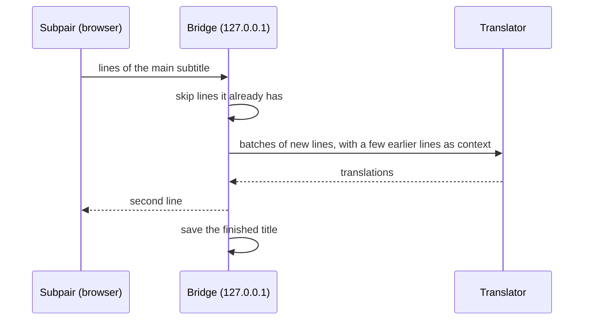

# Translation with the bridge

When a title has no subtitle track in your second-line language, Subpair can translate the main line through the
**bridge**, a small Node.js program on your computer (see [Setup](./#4-optional-install-the-bridge)). The bridge keeps
every translated line and every finished title, so nothing is paid for twice and a title you have watched loads at once.



## Settings files

The bridge reads, from lowest to highest priority:

1. `bridge/config.defaults.json`: every setting with its default (part of the code; do not edit).
2. `bridge/config.json`: your own changes. Start from `bridge/config.example.json`. It can hold API keys, so it is
   ignored by git.
3. Environment variables: `BRIDGE_PORT`, `BRIDGE_STORE`, `ANTHROPIC_API_KEY`, `OPENAI_API_KEY`.

A setting name that does not exist in the defaults file is an error, so a typo never silently does nothing. Restart the
bridge after changing a setting or an environment variable.

## Translators

| Translator | Key | Setting up |
|---|---|---|
| ezTrans | none | Windows only, Japanese to Korean. See [ezTrans](#eztrans). |
| Claude (`claude -p`) | none | Install [Claude Code](https://claude.com/claude-code) and run `claude` once to log in, as the same user that runs the bridge. Translations count against your Claude plan. |
| Anthropic API | `ANTHROPIC_API_KEY` or `api.key` | The default model is `claude-haiku-5-5`. |
| OpenAI-compatible | `OPENAI_API_KEY` or `openai.key` | Set `openai.baseUrl` and `openai.model`. Servers on your computer or local network usually need no key. |

The `claude` command is started without a shell. On Windows install Claude Code with its native installer (an `.exe`
on the PATH), or set `claude.command` to the full path of `claude.exe`.

Example `bridge/config.json` for Gemini through its OpenAI-compatible endpoint:

```json
{
  "openai": {
    "baseUrl": "https://generativelanguage.googleapis.com/v1beta/openai",
    "model": "<a Gemini model name>"
  }
}
```

and for a local [Ollama](https://ollama.com/):

```json
{ "openai": { "baseUrl": "http://127.0.0.1:11434/v1", "model": "<the model you pulled>" } }
```

Set a key for the terminal or service that starts the bridge:

| System | This session only | Permanently |
|---|---|---|
| Windows PowerShell | `$env:OPENAI_API_KEY = "<key>"; npm run bridge` | `setx OPENAI_API_KEY "<key>"`, then open a new terminal |
| macOS, Linux (bash, zsh) | `OPENAI_API_KEY="<key>" npm run bridge` | add `export OPENAI_API_KEY="<key>"` to `~/.zshrc` or `~/.bashrc` |

Services started by launchd (macOS) or systemd (Linux) do not read your shell profile: put the key in
`bridge/config.json` or in the service definition.

## Models

The Subpair settings have a **model** box per translator. Empty means the bridge's default, shown in grey while the
bridge runs. To change the default for everyone using this bridge, set it in `bridge/config.json`, for example:

```json
{ "claude": { "model": "sonnet" } }
```

A model name may use letters, digits and `. : / - _`. Each model's translations are saved separately, so switching
models never mixes them.

## How lines are sent

How lines are sent depends on the translator:

- **ezTrans** translates line by line, a few lines ahead of the video.
- The **language models** get batches of up to 40 lines as a numbered list, plus the 6 lines before the batch as
  context. A whole title is split into batches, lines already translated (or repeated) are skipped, and 2 batches run
  at a time (3 for the Anthropic API). A batch that comes back wrong is split in half and tried again; a single line
  that still fails is left out instead of failing the title.

Per translator you can change `batch`, `context`, `concurrency` and `timeoutMs` in `bridge/config.json`.

## What it costs

Rough cost of one anime episode of about 300 lines with the Anthropic API and Claude Haiku 5.5 (`claude-haiku-5-5`, the
default; $0.10 per million input tokens and $0.50 per million output tokens at the time of writing, see
[Anthropic's pricing](https://www.anthropic.com/pricing)):

| | Per episode | 12-episode season |
|---|---|---|
| Requests | about 8 (batches of 40 lines) | about 96 |
| Input | about 1,500 tokens per request | |
| Output | about 1,200 to 2,000 tokens per request | |
| **Cost** | **about $0.006 to $0.01** | **about $0.07 to $0.12** (under $0.30 with retries) |

These are estimates, not measurements: about one token per Japanese or Korean character, a 250-token instruction
and 6 context lines per request, and `api.effort` set to `low`. Lines already translated are never paid for again.
The Claude translator (`claude -p`) uses your Claude plan instead of per-token billing; ezTrans and local models cost
nothing per line.

## Saved translations

A finished title is saved in the bridge's data folder: `%LOCALAPPDATA%\subpair` on Windows,
`~/Library/Application Support/subpair` on macOS, `$XDG_DATA_HOME/subpair` or `~/.local/share/subpair` on Linux
(`storeDir` or `BRIDGE_STORE` change it).

In the player's gear menu:

- **Translator**, **When to translate**: Automatic, Live (a few lines ahead) or Whole title now.
- **Translator**, **Translate this title again**: makes a new translation that replaces the saved one (click twice).
- **Second subtitle**, **Translate from the main line instead**: ignores the title's own track in that language, for
  a bad or out-of-sync track. Remembered per title.

Other Jellyfin apps (TV, phone) do not see the saved translations.

## Run the bridge at startup

Use another port for the copy that always runs, for example 8777, so `npm run bridge` (8765) still works while you
develop. Set the extension's **Bridge address** to the same port.

### Windows

`scripts\windows\run-bridge.ps1` runs the bridge hidden, restarts it when it stops (waiting 5 s, doubling up to 60 s,
giving up after 8 quick failures in a row), allows only one copy per port, stops a bridge left running on that port,
and appends its output to a log (default `%LOCALAPPDATA%\subpair\bridge.log`). Register it as a scheduled task that
starts at logon and checks every 5 minutes (PowerShell, from the repository folder):

```powershell
$script   = (Resolve-Path 'scripts\windows\run-bridge.ps1').Path
$action   = New-ScheduledTaskAction -Execute 'powershell.exe' -Argument "-WindowStyle Hidden -NoProfile -ExecutionPolicy Bypass -File `"$script`" -Port 8777"
$triggers = @(
  New-ScheduledTaskTrigger -AtLogOn -User "$env:USERDOMAIN\$env:USERNAME"
  New-ScheduledTaskTrigger -Once -At (Get-Date).Date -RepetitionInterval (New-TimeSpan -Minutes 5)
)
$settings = New-ScheduledTaskSettingsSet -ExecutionTimeLimit (New-TimeSpan -Seconds 0) -MultipleInstances IgnoreNew -AllowStartIfOnBatteries -DontStopIfGoingOnBatteries
Register-ScheduledTask -TaskName 'Subpair bridge' -Action $action -Trigger $triggers -Settings $settings
Start-ScheduledTask -TaskName 'Subpair bridge'
```

Check it with `Invoke-RestMethod http://127.0.0.1:8777/health`. Options of the script: `-Port`, `-Log`, `-Repo`,
`-Node`, `-MaxQuickFailures`. To stop it for good: `Unregister-ScheduledTask -TaskName 'Subpair bridge'`, then end the `node` process
running `bridge\server.mjs`.

### macOS (not tested)

Save as `~/Library/LaunchAgents/com.subpair.bridge.plist`, with your paths (`which node` shows Node's):

```xml
<?xml version="1.0" encoding="UTF-8"?>
<!DOCTYPE plist PUBLIC "-//Apple//DTD PLIST 1.0//EN" "http://www.apple.com/DTDs/PropertyList-1.0.dtd">
<plist version="1.0">
<dict>
  <key>Label</key><string>com.subpair.bridge</string>
  <key>ProgramArguments</key>
  <array><string>/opt/homebrew/bin/node</string><string>/path/to/subpair/bridge/server.mjs</string></array>
  <key>EnvironmentVariables</key><dict><key>BRIDGE_PORT</key><string>8777</string></dict>
  <key>RunAtLoad</key><true/>
  <key>KeepAlive</key><true/>
  <key>StandardOutPath</key><string>/tmp/subpair-bridge.log</string>
  <key>StandardErrorPath</key><string>/tmp/subpair-bridge.log</string>
</dict>
</plist>
```

Then `launchctl bootstrap gui/$(id -u) ~/Library/LaunchAgents/com.subpair.bridge.plist`.

### Linux (not tested)

Save as `~/.config/systemd/user/subpair-bridge.service`:

```ini
[Unit]
Description=Subpair translation bridge

[Service]
Environment=BRIDGE_PORT=8777
ExecStart=/usr/bin/node /path/to/subpair/bridge/server.mjs
Restart=on-failure

[Install]
WantedBy=default.target
```

Then `systemctl --user enable --now subpair-bridge`.

## ezTrans

ezTrans XP is a Windows Japanese-to-Korean translator. The bridge talks to it through LunaTranslator's 32-bit helper
`LunaSubProcess32.exe`. Set three paths in `bridge/config.json`:

```json
{
  "eztrans": {
    "helper": "C:\\Tools\\LunaTranslator\\files\\LunaSubProcess32.exe",
    "dir": "C:\\Tools\\ezTrans XP",
    "cwd": "C:\\Tools\\LunaTranslator"
  }
}
```

`helper` is the helper program, `dir` the ezTrans XP folder, `cwd` the LunaTranslator folder. On macOS and Linux leave
ezTrans unset and use another translator.
